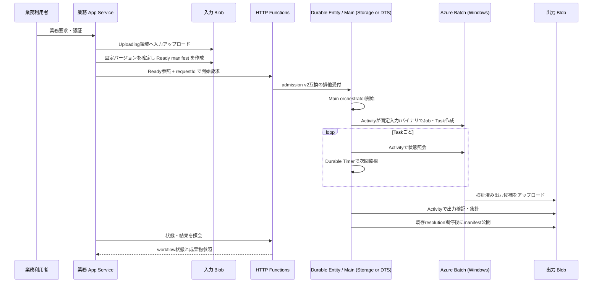

# App Service・Blob 入力・Batch 計算・Durable backend 比較の実装指示書

更新日: 2026-10-19  
適用基準: `f87b050`  既存の [P0 実装指示書](CODEX_IMPLEMENTATION_INSTRUCTIONS.md) は当時の履歴として維持し、本書はその後の次期業務連携フェーズに適用する。現行基盤の責務・制約は [プロジェクトメモリ](project-memory.md)、[信頼性設計](workflow-reliability.md)、[次期開発計画](next-implementation-plan.md) と合わせて読む。

## 目的と現状差分

業務アプリから確定済み入力を受け取り、既存の HTTP 受付・Durable 制御・Batch 監視を使って Windows 計算ノードで処理し、検証済みの出力だけを成果物として公開する。ここで App Service を追加する案は、ユーザー提示フローを受けた追加構成であり、既存オンプレミス backend の API 境界を優先し、フロントエンドや既存業務 backend の全面置換を前提にしない。実装の暫定候補は ASP.NET Core / .NET 10 の薄い backend とするが、上流利用者認証、既存 backend を置換するか、どの層が upload を担うかは未確定ゲートで合意してから固定する。金融モデル/計算ロジックを再実装しない。まず業務契約と実 C++ バイナリ仕様を確定し、その後に実装する。未知の業務仕様や Azure の未検証保証を仮定で埋めない。

現行 PoC は HTTP JSON → `admission.json` v2 → Durable Entity → Main orchestrator → Batch Job/Task → 子 Monitor orchestrator と Durable Timer → 結果集約・公開の経路を持つ。Durable backend は既定 `azureStorage` に加え `durableTaskScheduler` を選べる IaC/設定例が既にある。ただし DTS は別 Function App/state/environment に配置し、Azure Storage backend の history/entity state を移行する機能ではない。Storage は Durable provider として使わない場合でも、受付・業務入力・結果などの Blob 用途として残り得る。受付排他、冪等性、期限、利用者キャンセル、`resolution.json` による公開/取消調停も実装済み。ただし、独立した業務 App Service、入力 Blob 参照、実業務 C++、Batch `ResourceFiles`/`OutputFiles` による大容量転送はまだない。現在の Windows Task はダミーで `result.txt` に `1` を出力し、結果取得は Batch Task File API の 4 KiB 上限を持つ。従って現状の `sum=taskCount` は業務計算の完了を意味しない。

次期環境では Durable backend を `azureStorage` と `durableTaskScheduler` から選択できるようにし、既存 Storage 環境を既定・維持したまま DTS を比較用の独立環境として構築する。DTS の履歴移行や同一環境への in-place 差し替えは行わない。現行の [DTS 環境例](../environments/durable-task-scheduler.example.psd1) と `infra/durable-task-scheduler.tf` を再利用・評価し、同じ仕組みを別名で作り直さない。

## 目標フロー



App Service は同期的に計算を待たず、入力が `Ready` になってから受付 API を呼ぶ。HTTP `202` は受理を表し、計算成功や成果物公開を表さない。監視、期限、キャンセル、復旧は Durable の既存経路に残し、App Service にバックグラウンド Batch 監視ループや Batch 操作を持たせない。利用者向け状態・結果・取消 API の認証付き proxy は許可する。Orchestrator は決定性を保ち、外部 I/O は Activity に置く。入力/出力内容は orchestration history に渡さず、期限時刻と小さな参照値だけを渡して Durable Timer で監視する。出力候補 Blob は検証・公開前に利用者へ返さず、認可後に published manifest が指す結果だけを返す。図中の Durable backend は環境ごとの選択であり、1つの Function App を実行途中に切替えない。

## 契約・互換性・安全性の不変条件

1. **業務契約を先に凍結する。** バージョン付き request/input/output schema、CLI 引数、単位・文字コード・数値精度、最大 task 数、入力/出力の最大サイズ、許容誤差、エラー分類、owner/org の認可規則を ADR または契約文書に記録する。未受領項目は TBD とし、fixture の値を業務仕様として固定しない。
2. **旧受付と実行中履歴を壊さない。** 現行 `WorkflowRequest` と `admission.json` v2、fingerprint v1 は既存クライアントの契約として扱い、`requestId` の既存の global uniqueness を勝手に user-scoped に変えない。新しい入力参照は明示した `schemaVersion`、`mode`、`algorithmVersion` を持つ新契約として導入し、旧要求は従来どおり扱う。新 fingerprint version には input manifest identity、blob version/ETag、size、SHA-256、input schema、algorithm version と業務パラメータを含め、Batch Job/Task metadata と result manifest まで伝播する。既存 fingerprint v1 は旧要求の照合に残し、新規入力要求を v1 に丸めない。既存 orchestrator の serialized input/活動順序を途中変更して replay 互換性を仮定しない。別 Task Hub や別 Function 名だけでは、共有 admission Blob や決定的 Batch Job ID の衝突・二重実行を防げない。安全な切替は新規受付を停止し、旧実行の完走を待ってから新規受付先を切り替えること。並行稼働が必要なら、切替 routing と claim/Job ID 名前空間を先に定義し、owner の付替えや二重起動を防ぐ。既存 history を処理する互換経路と replay 回帰試験を用意する。
3. **Upload と Ready を分離する。** アップロード中の Blob を計算に渡さない。アップロード完了後にサーバー側でサイズ・SHA-256 を検証し、Ready manifest に schema version、owner/org、許可された container/key、Blob VersionId または固定 ETag、サイズ、hash、作成時刻を記録する。Batch は必ずその固定版を読む。Versioning が利用できない構成では ETag 条件付き読取で変更を拒否する。Ready manifest は条件付き作成し、同じ入力 identity の再試行のみ冪等にする。
4. **開始は Ready 後に冪等化する。** request ID、認証済み owner/org、契約 version、Ready manifest identity を一意性・競合判定に含める。同じ組み合わせの再送は同じ Durable instance に解決し、異なる入力や所有者の再利用は conflict/forbidden とする。Blob upload 完了前に workflow を開始しない。受付後の再送を exactly-once と説明しない。
5. **認証済み principal から所有者を決める。** App Service の Managed Identity に必要最小限の API 権限/App Role を付与し、Function 側は現行 EasyAuth/App Role/backend app-only principal 検証を維持する。現 HTTP trigger は Function authorization level も要求するため、Entra Bearer だけで動く前提にせず、App Role と Function key の両方を使う方式、または安全に承認された変更を設計する。key の安全な App Service 供給・保管・rotation を決め、URL、ログ、成果物へ出さない。ブラウザーや任意 caller が送った `X-Poc-Owner-Id` / `X-Poc-Org-Id` を本人証明として信用しない。信頼された backend が認証した利用者を承認済み owner/org に写像し、その assertion を Functions に渡す。Functions は呼出元 backend principal/App Role、owner/org の形式、保存済み request の owner 一致を検証する。利用者本人性とその owner mapping の正当性は backend/上流認証層の責任で、Functions が独立に証明したとは説明しない。既存 ownerless `admission.json` v2 の request に後から owner を割り当てない。既存の一般 `Invoke-PocValidation` runner は通常の Entra Bearer 認証を扱えないため、Entra token/App Role と Function key の統合試験を計画に含める。
6. **結果は完了コードだけで成功にしない。** Batch Task の終了状態・exit code・failure 情報に加えて、全期待出力の存在、固定された出力名、サイズ上限、hash、schema、入力との関連付け、業務許容誤差を検証する。欠落・部分 upload・重複・不正 path・不一致は失敗にし、公開 manifest を作らない。検証済み出力と集計を Blob に保存し、既存 `resolution.json` の成功/取消排他を通過した後にだけ `manifest.json` を公開する。新しい公開権威や取消状態を追加しない。
7. **大容量データとパスを安全に扱う。** Functions メモリに全入力・出力を読み込まず、ストリームまたは SDK の転送 API を使う。Blob key はサーバーが request/task ID と固定 allowlist から生成し、ユーザー指定 path を結合しない。ノード上の作業ディレクトリも固定し、ファイル名・親ディレクトリ参照を許可しない。署名 URL を使う設計が必要な場合は有効期限・権限・ログ露出を一次資料で確認し、採用判断を記録する。

Ready manifest の小さい例（実際の field 名・canonicalization は schema 凍結時に決める。API caller が任意 URI/key を指定できる契約にはしない）:

```json
{
  "schemaVersion": 1,
  "readyManifestId": "input-01J...",
  "ownerId": "resolved-owner-id",
  "orgId": "resolved-org-id",
  "blob": {
    "container": "workflow-input",
    "blobKey": "owners/o-123/inputs/i-456/input.dat",
    "versionId": "2026-10-19T00:00:00.0000000Z",
    "etag": "\"0x8...\"",
    "sizeBytes": 12345,
    "sha256": "<64 lowercase hex characters>"
  }
}
```

新 workflow contract は `schemaVersion`, `mode`, `algorithmVersion`, `requestId`, `readyManifestId`, 業務パラメータを持つ。owner/org は信頼された backend が認証した principal から解決し、受付時に manifest の owner・hash・固定 Blob identity と照合する。入力契約 version と実行アルゴリズム version は別々に記録する。

| 操作 | backend/App Service と Functions の責務 |
|---|---|
| Upload | 利用者認可、許可サイズ・形式・key で Uploading を開始する |
| Finalize | upload 完了を検証し、固定版・size/hash を記録した Ready manifest を条件付き作成する。Ready 前は Start 不可 |
| Start | `requestId + owner/org + contract/algorithm version + readyManifestId` を照合し、既存 admission を通して冪等に開始する。202 を返す |
| Status / Result | 既存の custom status/result Functions API を backend が認証付きで照会し、caller に proxy する。Durable monitor を置き換えない。Durable management URL/system key は caller へ露出しない |
| Cancel | 既存 cancel API に owner 認可済み要求を転送し、Durable の取消結果を返す |

Ready manifest 保存後・Start 呼出前に App Service が停止した場合、再試行は同じ manifest ID と同じ request ID で Start を呼ぶ。Start 応答喪失も同じキーで再送し、既存 admission の冪等性に解決させる。manifest の version/hash が変わった場合や別 owner/request に付替える場合は自動再利用せず conflict/authorization error とする。

## Windows 実行物とネットワーク

- 実 C++ CLI、固定バージョン、依存 DLL/VC++ Runtime、設定ファイル、ライセンス要件、引数、終了コード、出力仕様を業務側から受領する。Batch `ResourceFiles` または Application Package 等の配布方式を比較する。MI の ResourceFiles を採る場合、Pool に UAMI を割り当て、入力 container の最小 Reader 権限と `resourceFile.identityReference` を構成する。Pool MI の変更は Management Plane/Entra の権限・伝播に依存し、既存 active node に自動反映されると仮定しない。実行物と依存物を固定バージョン/hashで検証して起動し、ユーザー由来 filename、任意 Blob URI、任意 command/shell を実行引数へ注入しない。
- Ready manifest の VersionId は記録するが、Batch `ResourceFiles` URL が VersionId を使った取得を保証するとは見なさない。ETag は条件値であり、それ単独で不変版の参照ではない。VersionId 固定の SDK/MI downloader と `If-Match` を含む取得方式を比較し、Windows node 上の MI + Private Endpoint + version pinning を小規模実機で検証する。未確認なら通常 Blob URL に黙って退化させない。Blob versioning も削除防止ではないため、必要な保持期間・削除権限・必要時の immutability/WORM を別途決める。
- 出力は Batch `OutputFiles` を使った Blob 直送を基本候補とする。Pool UAMI、出力 container の最小 Contributor 権限、`OutputFileBlobContainerDestination.IdentityReference` を構成し、失敗時の挙動を試験する。OutputFiles の upload 失敗でも Task が `Completed` になり得るため、Task exit 0 だけでは成功にしない。再試行/Spot 再キュー用に attempt 別 staging prefix を作り、期待する attempt を選んで条件付き確定するか、同一 hash のみ条件付き再送を許す。全期待 Blob の存在・size/hash/schema と Batch の failure 情報を検証する。SDK/Batch の保証は一次資料と対象 API/SKUを確認する。実ファイル未受領でも fixture で転送機構を試験できるが、実 C++ 完了の証拠にはせず業務受入は保留する。
- 現在の閉域化は Functions と Batch のネットワーク経路が中心で、Storage の Blob 公開エンドポイント通信は残る。Storage 全面閉域化では Blob/Queue/Table の Private Endpoint と DNS を整備し、Durable state 用 Storage が別ならその経路も確認する。閉域検証 VM/runner、VPN または ExpressRoute、Private DNS の接続・名前解決・到達性を先に確保し、実際の転送試験を通してから Storage の public network access を閉じる。現行 deploy はローカル Terraform とローカル Blob 転送を使うため、VM bridge だけ追加しても deploy/artifact 転送は閉域完結しない。
- App Service の inbound Private Endpoint と outbound VNet Integration は別の経路として設計する。現行 Dedicated B1 Function App に Azure Files share は不要であり、必要性・プラン要件が確認されない限り追加しない。ARM 制御面、Entra token 取得などの残通信経路を棚卸しし、「インターネット通信ゼロ」とは実測・構成確認なしに保証しない。DTS を選ぶ場合は専用 scheduler Private Endpoint/DNS と PNA 無効化をこの段階で実施する。AMPLS は要件がある場合のみ別の後続段階とする。
- 新規専用 Batch は `batch_mode=new` の構成だけを対象にする。`batch_mode=existing` の共有 Batch/Pool は作成・更新・停止・autoscale変更をしない。デプロイの destructive plan guard、pool recreation の明示 opt-in は維持し、実業務検証に共有 Pool の設定変更を混ぜない。

## Durable backend の選択・比較環境

- `durable_backend=azureStorage` を既定値として維持し、この構成では DTS scheduler/task hub の課金リソースを作らない。既存の値 `azureStorage` / `durableTaskScheduler` をそのまま使い、新しい `storage` / `dts` enum は導入しない。`durable_backend=durableTaskScheduler` は利用者が選ぶ別環境の構成とし、先に [既存の DTS example](../environments/durable-task-scheduler.example.psd1)、`infra/durable-task-scheduler.tf`、deploy の環境 identity guard と provider 登録を読み、足りない差分だけを実装する。deploy は Environment identity 内の backend/Hub 変更を拒否し state key は Environment 名から決まるため、このガードを外して同一環境を切り替えない。
- 比較環境は専用 Resource Group、Terraform state key/Environment 名、state 用 Storage account/container とその Blob PE/Private DNS（閉域運用する場合）、Function App とアプリ名 suffix、Task Hub、Function Managed Identity、host/business Storage、admission/claim namespace、結果 prefix、Batch Job/task ID namespace を持つ。Storage backend 環境を DTS に向け直さない。別 Task Hubだけでは外部 Blob claim、成果物 key、Batch ID の衝突・二重実行を解消しないので、同時受付するなら名前空間または明示的な切替 routing を契約・テストする。安全な切替は新規受付を停止し、旧環境の実行完了を待ってから新規受付先を切り替える。旧実行の status/result/cancel 要求は必要な保持期間、旧環境へ routing する。Rollback 時は新環境の新規受付を停止し、そこで既に受け付けた実行は新環境のまま完了させ、新規要求だけ旧環境に戻す。履歴や Entity state を移送しない。
- state backend Storage の private 化では Terraform bootstrap state をローカルに保持したまま、別 state Storage account とその Blob Private Endpoint/Private DNS を準備する。private runner/VPN から DNS・Blob 到達性を確認し、remote backend の init/plan/apply を同じ閉域経路で実行できることを確かめてから state Storage の PNA を無効化する。初回 PE 作成中に public access を一時利用する場合は、その移行期間だけに限定し証跡化する。bootstrap state は remote state と独立に保持・バックアップし、消失で backend/bootstrap の復旧手段を失わないようにする。Terraform state 用 Storage と host/business Storage は分離し、各々の endpoint・PE・DNS・権限を個別に設計する。
- DTS 環境は別 RG、別 Function App/Managed Identity、別 scheduler/task hub、別 host/business Storage、別 Terraform state key、固有 suffix とする。完全な実行分離の基本は専用 `batch_mode=new` pool と専用 App Service plan である。既存 DTS example の共有 Batch Pool 参照はコスト比較用に限り、明示選択時のみ使用する。共有 Pool を使う場合、実行負荷・quota・Job名衝突・結果残存などが分離されないこと、Pool設定は変更しないことを合意し、結果/Job ID を別 namespace にする。同一 `requestId` を Storage/DTS 両環境に投入しない。
- 専用 DTS 環境は Function MI に Task Hub scope の `Durable Task Data Contributor` を割当て、`scheduler` group ID の Private Endpoint と Private DNS を作成する。scheduler の通常 FQDN が PE IP に解決されることを確認してから `publicNetworkAccess=Disabled` にする。PE はネットワーク経路であり Durable Task authorization の代替ではない。Consumption/Dedicated の Private Endpoint 対応は公式資料で確認済みだが、対象 region/SKU、Functions subnet/PE subnet、DNS、Dashboard 管理アクセスは専用環境で検証する。既存 DTS/Storage 環境の public access は触らない。scheduler endpoint を閉域化しても ARM、Entra、Blob、Batch の public 経路が自動で閉じるとは限らない。
- Durable provider の変更は history/entity migration ではない。DTS の retention policy（例: 30日）は Durable Entity/外部 admission claim/Blob 入出力の保持期間や TTL を自動で決めない。admission/claim/results の保持・cleanup を別に定める。受付同時実行の実証範囲（20並列など）を backend 間で同じ条件で再確認し、未検証を保証にしない。
- backend ごとに package/runtime settings、Task Hub、認証、HTTP API、Entity、restart/recovery、cancel、deadline、output publish を検証する。DTS の過去実機証跡は旧 12 関数時点であり、最新 15 関数、取消、認証、閉域、入力/output path の回帰実証と同一視しない。追加業務経路を含む同じ回帰セットを両環境で通す。Scheduler SKU/region availability、retention/cost、history upgrade/migration 可否は Microsoft 一次資料と対象環境で確認し、未確認事項は比較結果に残す。既存 Azure Storage history を DTS に移行できるとは扱わない。

PlanOnly の準備例（以下は説明用。まず複製した config の subscription/RG/suffix/state/Hub、専用 `batch_mode=new`、network を設定し、placeholder を残したまま実行しない。既存 DTS sample は共有 `batch_mode=existing` なので、完全隔離の比較環境にそのまま使わない）:

```powershell
Copy-Item environments/durable-task-scheduler.example.psd1 environments/dts-isolated.psd1
./scripts/deploy.ps1 -Environment dts-isolated -ConfigFile ./environments/dts-isolated.psd1 -PlanOnly
```

## 実装段階と受け入れ条件

| 段階 | 主な対象・成果物 | 依存 | 受け入れ条件 |
|---|---|---|---|
| 0. 契約・backend 選択 | 新規 `docs/` 契約・schema/backend decision。業務側から CLI/入出力/誤差/最大容量/owner 認証情報を受領 | 業務アプリ・既存 backend・セキュリティ・運用の合意 | TBD が明示され、App Service/Functions/Batch が同じ versioned contract を参照。Storage 既定を維持し、DTS比較を行うか決定。別RG/state/Hub/namespace、切替・drain方針を記録。未確定の業務仕様に依存しない fixture/infra 作業は進めてよい |
| 1. Input Ready | `src/Poc.Core/Contracts.cs`、Blob repository、Functions admission/API と `tests/Poc.Tests`。upload/finalize API または backend 側 finalize 処理 | 0、Storage 権限・Versioning/ETag 方針 | 未完了・改変・hash/size 不一致入力を開始拒否。Ready 固定版を再送して同一要求は冪等、別入力は conflict。旧 admission v2 と実行中履歴の互換テスト合格 |
| 2. 業務 backend 接続 | 必要な場合のみ新規 ASP.NET Core/.NET 10 App Service/API、MI/App Role/IaC、運用設定、API 統合試験 | 0–1、上流利用者認証と owner/org map | 認証不足/他 owner を拒否。Ready 後に既存開始 API を呼ぶ。202 と最終結果を区別。Function key の発行・取得・保管・rotation を決め、最小権限で行う。key/token/Durable management URL を caller/log に露出しない。既存 backend を置換しない判断も受入可能 |
| 3. Batch input/binary | `src/Poc.Core/AzureBatchGateway.cs`、Task spec/plan、必要な `infra/` RBAC、Batch テスト | 0–1、実バイナリがあれば依存物受領・配布方式決定。未受領中は明示的 fixture mode で実装可 | Node が固定入力版/hashを検証して固定版バイナリを実行。古い/異なる入力、取得失敗、非ゼロ終了を失敗として報告。ResourceFiles identity または downloader が node 上で機能することを検証。fixture pass と実バイナリ受入を分離。`existing` Batch を変更しない |
| 4. OutputFiles/検証・公開 | `src/Poc.Core/WorkflowOperations.cs`、Blob repository、manifest/output schema、Functions Activity、テスト | 0–3、最大出力容量と誤差基準 | 一部欠落/破損/余分な task 出力で manifest 非公開。全検証後にのみ resolution 成功調停と manifest 公開。取消との競合で一方だけが勝つ |
| 5. 閉域・運用統合 | `infra/` Storage PE/DNS/VNet、`scripts/` deploy/runner/private VM、ネットワーク証跡 | 0 のネットワーク設計確定後に先行して並行可。runner/VPN/DNS/経路を準備 | Blob/Queue/Table/state の必要経路を private 接続から確認後にのみ PNA 閉鎖。Functions、App Service inbound/outbound、App Service SCM/private DNS・deploy、Batch node、artifact transfer を個別検証。App Service は PE/DNS/SCM 疎通確認後に PNA を閉鎖。公開経路遮断テストも合格 |
| 6. DTS 比較環境（選択時） | `environments/` の新規環境 config、既存 DTS infra/deploy/runner 再利用、scheduler PE/DNS/PNA 閉鎖、`docs/durable-task-scheduler-poc.md` 更新、backend別証跡 | 0、別 RG/state/Hub/Function・MI/Storage/Batch と課金/region/network 確認。Batch/App Service/閉域作業と契約確定後に並行可能 | `azureStorage` 既定と既存環境は不変。専用 identity/suffix と独立stateで DTS 作成。専用 scheduler PE/DNS 接続を確認して PNA を閉鎖。履歴移行を主張せず、DTS固有の起動・監視・復旧・cancelを Azure で確認。既存 DTS 文書の古い関数数/test数を最新実証と混同しない。共有 Batch 利用は明示 opt-in とし、共有影響を記録。比較用破壊/停止試験は環境間で直列化 |
| 7. 実機受入 | `docs/test-results.md` 等の証跡更新 | 0–6、選択する backend ごとの実 Azure・実 C++・代表データ | 小/最大想定入力、複数 task、再送、取消、期限、Function restart、task失敗、upload途中失敗、結果検証、owner拒否、閉域 deny を実施。DTS比較を選んだ場合は同じシナリオを両 backend で実施。ローカル Fake と Azure 実機結果を分けて記録 |

段階 0 の契約凍結後は、App Service/API、Batch 入出力、DTS 環境/runner 比較の実装を別担当で並行可能。ただし共通 schema と認証・所有者・path 規約の変更は合意なしに分岐させない。環境作成・破壊試験・Pool 操作は同一資源に影響し得るため並列実行せず、各環境で直列にする。ユーザー指示に従い、低複雑度の実装・テストは luna へ委譲し、親を orchestrator/統合レビュー担当とする。Durable replay、認可、成果物公開排他など複雑な領域は適切な専門担当がレビューする。

## 必須回帰・失敗注入

**ローカル試験**では Mock/Fake で入力 manifest の欠損・hash/ETag 不一致・owner 不一致、request 再送と別入力競合、Task 非ゼロ、入力/出力 download 失敗、OutputFiles の欠落・部分 upload・重複・巨大サイズ超過、結果 schema/誤差不一致を検証する。どの場合も成功 manifest が出ないことを確認する。既存の admission、restart/recovery、期限、cancel/`resolution.json` 競合、停止再試行のテストも維持する。Durable orchestrator の変更は旧 history を含む replay/upgrade compatibility を明示的に試験する。

**Azure 実機試験**では App Service MI/App Role と Function 認証、実 Windows node の固定バイナリ/依存物、Blob version/ETag 固定、代表サイズと最大想定サイズの転送、Storage private DNS/PE、public access 拒否、deploy/runner の到達経路を確認する。実バイナリを受領していない場合、fixture の pass は「転送/契約機構の検証」に限り、業務計算受入を Pass と記録しない。Azure 実施前に対象 Batch が専用 `new` であることと plan guard の出力を確認する。

## 未確定ゲート

次の項目は業務・運用の確定待ちであり、本書では推測しない: 実 C++ CLI/バージョン/依存 DLL、入力・出力 schema と許容誤差、通常/最大ファイルサイズと task 数、上流ユーザー認証方式と owner/org の正式な対応規則、既存 backend のAPI境界を維持するか/App Service backend を追加するか、保持期間・削除責任、容量・同時実行・Batch quota、必要な App Service SKU/Private Endpoint 要件、DTS を比較環境として構築するか、対象 region/SKU/価格/保持・ネットワーク要件。これらが確定するまでは、本番容量・費用・SLA や全通信閉域を保証しない。

## 公式一次資料の確認

実装担当は採用する API/SDK バージョンに合わせ、[Durable Functions versioning](https://learn.microsoft.com/en-us/azure/durable-task/durable-functions/durable-functions-versioning)、[Azure Storage provider](https://learn.microsoft.com/en-us/azure/durable-task/durable-functions/durable-functions-azure-storage-provider)、[Durable Task Hubs](https://learn.microsoft.com/en-us/azure/durable-task/common/durable-task-hubs)、[DTS quickstart](https://learn.microsoft.com/en-us/azure/durable-task/scheduler/quickstart-durable-task-scheduler)、[DTS private endpoints](https://learn.microsoft.com/en-us/azure/durable-task/scheduler/durable-task-scheduler-private-endpoints)、[App Service authentication](https://learn.microsoft.com/en-us/azure/app-service/overview-authentication-authorization)、[App Service private endpoint](https://learn.microsoft.com/en-us/azure/app-service/overview-private-endpoint)、[App Service VNet integration](https://learn.microsoft.com/en-us/azure/app-service/overview-vnet-integration)、[Storage private endpoints](https://learn.microsoft.com/en-us/azure/storage/common/storage-private-endpoints)、[Batch ResourceFiles](https://learn.microsoft.com/en-us/azure/batch/resource-files)、[Batch OutputFiles](https://learn.microsoft.com/en-us/azure/batch/batch-task-output-files)、[Batch Managed Identity for pools](https://learn.microsoft.com/en-us/azure/batch/managed-identity-pools)、[Blob concurrency/ETag](https://learn.microsoft.com/en-us/azure/storage/blobs/concurrency-manage)、[Blob versioning](https://learn.microsoft.com/en-us/azure/storage/blobs/versioning-overview)、[Get Blob REST API](https://learn.microsoft.com/en-us/rest/api/storageservices/get-blob)、[Private Endpoint overview](https://learn.microsoft.com/en-us/azure/private-link/private-endpoint-overview) を確認し、採用 API/SKU の設計記録にリンクする。`OutputFileBlobContainerDestination` の SDK surface は [API reference](https://learn.microsoft.com/en-us/dotnet/api/azure.compute.batch.outputfileblobcontainerdestination?view=azure-dotnet) も参照する。具体的な挙動保証は資料と対象 SKU/API の確認後に記載する。本書にない Azure 保証を一般化しない。
