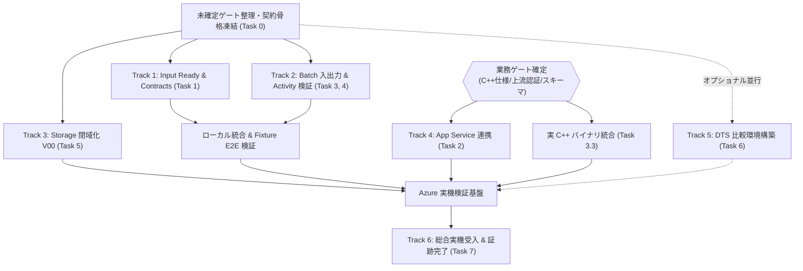
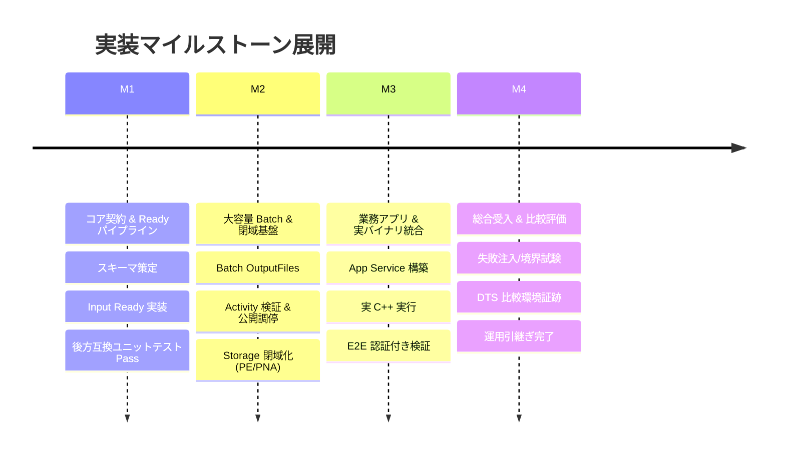

# 実装作業計画書: App Service・Blob 入力・実業務 Batch 計算・Durable 比較環境

更新日: 2026-10-19  
適用基準: [`docs/app-service-blob-batch-implementation-instructions.md`](file:///D:/durable_functions_poc/docs/app-service-blob-batch-implementation-instructions.md) / コミット `b671eec`

---

## 1. 基本方針と実行戦略

本計画は、[`docs/app-service-blob-batch-implementation-instructions.md`](file:///D:/durable_functions_poc/docs/app-service-blob-batch-implementation-instructions.md) に定められた段階 0〜7 の要件に基づき、**「未確定な業務仕様（C++バイナリやスキーマ）の確定を待たずに進められる基盤実装」**と**「業務仕様確定後に着手する連携実装」**を分離し、手戻りのない段階的推進を実現するための作業計画です。

### 3 つの推進原則
1. **Fixture 先行によるアンチブロッキング**: 実 C++ バイナリや本番スキーマが未受領でも、ダミーの計算実行物（Fixture モード）を用いて大容量ファイル転送・ハッシュ検証・状態遷移・キャンセル競合のパイプラインを先行実装・単体検証する。
2. **既存契約・安全基盤の不可逆性の維持**: `admission.json` v2、`cancel.json` / `resolution.json` の排他調停、`azureStorage` 既定動作を一切破壊せず、後方互換を厳格に保持する。
3. **環境・状態の完全分離**: DTS 比較環境は、既存 Azure Storage 環境の in-place 変更を行わず、専用の独立環境（別 RG、別 state、別 Task Hub）として並行検証する。

---

## 2. 作業分解構成図 (WBS) とタスク詳細

### Track 0: 契約定義・スキーマ策定（段階 0）

| タスク ID | 作業項目 | 主な対象ファイル | 依存関係 | 完了条件 (DoD) |
|---|---|---|---|---|
| **TASK-0.1** | Ready Manifest スキーマ & WorkflowRequest v2 定義 | `src/Poc.Core/Contracts.cs` | なし | Ready Manifest（JSON スキーマ）、入力契約 version、Fingerprint v2 構造体の C# 定義完了。 |
| **TASK-0.2** | 未確定ゲート一覧と合意チェックシートの作成 | `docs/` | なし | 業務側・インフラ側と合意すべき項目（C++ 仕様、最大ファイルサイズ、認証方式）が ADR 形式で整理されていること。 |

### Track 1: Input Ready パイプライン & 受付拡張（段階 1）

| タスク ID | 作業項目 | 主な対象ファイル | 依存関係 | 完了条件 (DoD) |
|---|---|---|---|---|
| **TASK-1.1** | Ready Manifest の Blob 保存・取得・ハッシュ検証ロジック実装 | `src/Poc.Core/WorkflowOperations.cs` `src/Poc.Core/BlobStorageRepository.cs` | TASK-0.1 | ETag 条件付き作成、SHA-256 / サイズ検証、不変性チェックの共通処理が実装されていること。 |
| **TASK-1.2** | Functions 受付 API（`StartWorkflow`）の Ready 参照対応 | `src/Poc.Functions/WorkflowHttpStarters.cs` | TASK-1.1 | Ready Manifest 参照付き要求を受理し、`admission.json` v2 と整合した排他受付ができること。旧形式要求との後方互換テスト合格。 |
| **TASK-1.3** | Input Ready 単体・結合テストの作成 | `tests/Poc.Tests/WorkflowAdmissionTests.cs` | TASK-1.2 | 未完了・サイズ不一致・ハッシュ不一致の入力要求が 400/409 で拒否され、正常要求が 202 を返す Mock/Fake テストが合格すること。 |

### Track 2: Batch 大容量入出力 & 検証・成果物公開（段階 3 & 4）

| タスク ID | 作業項目 | 主な対象ファイル | 依存関係 | 完了条件 (DoD) |
|---|---|---|---|---|
| **TASK-2.1** | Task Plan への ResourceFiles（UAMI 参照）定義追加 | `src/Poc.Core/AzureBatchGateway.cs` | TASK-0.1 | Batch Task 定義に Blob 入力の ResourceFiles（固定 VersionId / ETag / UAMI 参照）を付与できること。 |
| **TASK-2.2** | Batch Task への OutputFiles（Blob 直送）定義追加 | `src/Poc.Core/AzureBatchGateway.cs` | TASK-2.1 | `OutputFileBlobContainerDestination` を使用し、ノードから Blob への直接アップロード設定ができること。attempt 単位のプレフィックス分離に対応。 |
| **TASK-2.3** | 出力 Blob 検証・集約 Activity の実装 | `src/Poc.Core/WorkflowOperations.cs` `src/Poc.Functions/Activities/` | TASK-2.2 | ノード終了後、Activity が Blob の実在・サイズ・ハッシュ・スキーマをストリーミング検証し、欠損・破損時はタスク失敗と判定すること。 |
| **TASK-2.4** | 成果物公開調停（`resolution.json`）とキャンセル排他統合 | `src/Poc.Core/WorkflowOperations.cs` `src/Poc.Functions/Orchestrators/` | TASK-2.3 | 出力検証成功時のみ `resolution.json` を通して `manifest.json` を公開し、キャンセル要求との競合調停が正しく機能すること。 |
| **TASK-2.5** | Fixture モードによるローカル回帰テストスイート整備 | `tests/Poc.Tests/BatchExecutionTests.cs` | TASK-2.4 | ダミー C++ 出力・異常終了・OutputFiles 欠損・キャンセル競合の各シナリオで想定通りのステータスになる Fake テストが全て Pass すること。 |

### Track 3: Storage 閉域化（V00 対応・段階 5）

| タスク ID | 作業項目 | 主な対象ファイル | 依存関係 | 完了条件 (DoD) |
|---|---|---|---|---|
| **TASK-3.1** | Storage Private Endpoints (Blob/Queue/Table) IaC 実装 | `infra/storage.tf` `infra/private-dns.tf` | なし | Storage Account に対する Private Endpoints および Private DNS Zones (`privatelink.blob/queue/table.core.windows.net`) の Terraform 定義。 |
| **TASK-3.2** | 閉域アクセス到達性・疎通テストスクリプト作成 | `scripts/Test-PrivateStorageConnectivity.ps1` | TASK-3.1 | Validation VM および Functions から Private IP 経由で Storage 各サービスへ疎通できることを確認するスクリプト。 |
| **TASK-3.3** | Storage Public Network Access (PNA) 遮断と検証 | `infra/storage.tf` `scripts/deploy.ps1` | TASK-3.2 | PNA を `false` に切り替えた状態で既存の Private 検証シナリオが完走し、外部インターネットからの直接アクセスが拒否されること。 |

### Track 4: 業務 App Service 連携（段階 2 ※業務ゲート確定後）

| タスク ID | 作業項目 | 主な対象ファイル | 依存関係 | 完了条件 (DoD) |
|---|---|---|---|---|
| **TASK-4.1** | App Service インフラ定義 (B1/UAMI/PE/VNet統合) | `infra/app-service.tf` | GATE_BIZ | ASP.NET Core 用 App Service、UAMI、Inbound Private Endpoint、Outbound VNet 統合の IaC。 |
| **TASK-4.2** | App Service 上流 API 実装（Upload/Finalize/Start/Status Proxy） | `src/Poc.AppService/` | TASK-1.2, TASK-4.1 | クライアントからのアップロード受付、Ready Manifest 生成、Functions 受付 API 呼び出し（App Role 認証）、状態照会プロキシの実装。 |
| **TASK-4.3** | S2S 認証・App Role 認可・所有者マッピング統合テスト | `scripts/Invoke-AppServiceValidation.ps1` | TASK-4.2 | 認証済み App Service からのワークフロー起動・照会・キャンセルの E2E シナリオ検証。 |

### Track 5: DTS 比較環境の構築・検証（段階 6 ※選択時・並行可）

| タスク ID | 作業項目 | 主な対象ファイル | 依存関係 | 完了条件 (DoD) |
|---|---|---|---|---|
| **TASK-5.1** | DTS 独立環境構成ファイル整備 | `environments/dts-isolated.psd1` | なし | 専用 RG、suffix、独立 state key、専用 Task Hub、専用 `batch_mode=new` の構成パラメータ定義。 |
| **TASK-5.2** | DTS Scheduler Private Endpoint & DNS 構成 | `infra/durable-task-scheduler.tf` | TASK-5.1 | DTS Scheduler への Private Endpoint 作成、Private DNS Zone 設定、PNA 無効化の IaC。 |
| **TASK-5.3** | DTS 最新 15 関数・取消・認証回帰検証 | `scripts/Invoke-PrivatePocValidation.ps1` | TASK-5.2 | 最新のオーケストレーション、キャンセル、認証、閉域経路が DTS 環境上で正常動作することの Azure 実機証跡採取。 |

### Track 6: 総合実機受入 & 運用引継ぎ（段階 7）

| タスク ID | 作業項目 | 主な対象ファイル | 依存関係 | 完了条件 (DoD) |
|---|---|---|---|---|
| **TASK-6.1** | 実 C++ バイナリ・代表データの統合実機試験 | `docs/test-results.md` | Track 1〜4 | 実業務バイナリを Windows ノード上で実行し、代表サイズ・最大サイズでの大容量転送・集約・成果物公開が成功すること。 |
| **TASK-6.2** | 全異常系・失敗注入・境界回帰試験 | `docs/test-results.md` | TASK-6.1 | ノード障害、タイムアウト、キャンセル競合、サイズ超過、ハッシュ改ざん時の安全停止・エラー通知を Azure 実機で確認。 |
| **TASK-6.3** | 本番化引継ぎ書・最終運用のドキュメント化 | `docs/` | TASK-6.2 | システム構成図、運用手順、監視メトリクス、コスト比較（Storage vs DTS）をまとめた最終納品ドキュメントの作成。 |

---

## 3. 実装マイルストーンと段階別受け入れ基準

- **マイルストーン 1 (M1): コア契約 & Ready パイプライン確立**
  - **対象**: Track 0, Track 1 (TASK-0.1 〜 TASK-1.3)
  - **完了条件**: ローカル単体テスト・Mock テストが全て Pass し、旧要求・新要求の双方に対して決定性と排他性が保証されていること。
- **マイルストーン 2 (M2): 大容量 Batch 機構 & Storage 閉域化の完了**
  - **対象**: Track 2 (TASK-2.1 〜 TASK-2.5), Track 3 (TASK-3.1 〜 TASK-3.3)
  - **完了条件**: Fixture モードでの Batch 大容量転送・検証が動作し、Storage の PNA を遮断した完全閉域環境で検証が成功すること。
- **マイルストーン 3 (M3): 業務アプリ・実バイナリ統合**
  - **対象**: Track 4 (TASK-4.1 〜 TASK-4.3), TASK-2.1（実バイナリ適用）
  - **完了条件**: App Service からの入稿・Ready 確定・ワークフロー実行・結果取得が Entra サービス間認証下で完走すること。
- **マイルストーン 4 (M4): 総合実機受入 & DTS 比較完了**
  - **対象**: Track 5, Track 6 (TASK-5.1 〜 TASK-6.3)
  - **完了条件**: 実機受入シナリオが全て Green となり、本番運用の判断材料（DTS 比較結果含む）が揃うこと。

---

## 4. 直近のアクションアイテム（推奨着手順序）

1. **直ちに着手可能な作業（M1）**:
   - `src/Poc.Core/Contracts.cs` への `ReadyManifest` および `WorkflowRequest` v2 定義の追加（TASK-0.1）
   - `BlobStorageRepository` への Ready Manifest 作成・ハッシュ検証ロジックの実装（TASK-1.1）
   - `tests/Poc.Tests` での後方互換および Ready 境界テストの作成（TASK-1.3）
2. **並行してステークホルダーへ確認すべきゲート事項**:
   - 実 C++ バイナリの配布要件（ResourceFiles の直接配置でよいか、前提ランタイム等）
   - 想定される最大入力ファイルサイズ（GB 単位か否か）および許容される計算タイムアウト値
   - 既存 Web バックエンドとの境界方針（App Service を新設するか、既存バックエンドにクライアント機能を組み込むか）
