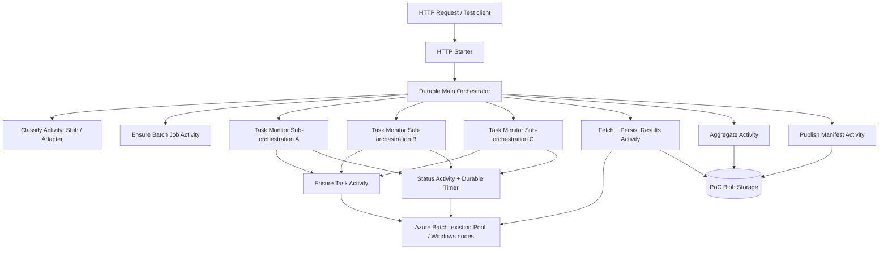

# Azure HPC マネージド化 PoC 設計書 — Durable Functions重点版

- 更新日: 2026-10-16
- 対象: HPC Pack / IBM Spectrum LSF から Azure Batch + Durable Functions への機能移管可能性
- PoCの主目的: **Durable Functions による非同期ワークフロー制御の技術的実現可能性を確認する**
- 計算ノードOS: **Windows Server**
- 計算形態: 原則 **1 Task = 単一ノード内完結**
- フェーズ: 実装前設計。Codex に実装を委譲する。

## 0. 既知の前提と設計判断

### 確認済み
- Azure Batch Pool は Azure Compute Gallery イメージから展開した実績があり、必要権限の調査も完了している。
- 既存の HPC 業務で軽量・重量の分類処理は存在する。**PoCでは業務判定ロジックそのものを開発しない**。
- 実際の数値計算処理の再現性は評価対象外。Windows上で動く小さなダミーTaskで代替する。
- HPC Pack / LSF の完全代替検証ではなく、**Durable Functions が従来の独自オーケストレーションをどの程度不要にできるか**が第一目的。

### 今回の確定方針
1. **既存Batch Account / 既存Pool / ACGは読み取り・参照専用**。Terraformは原則としてPoC固有のFunction App、状態保存Storage、Blob Container、監視、必要RBACのみ管理する。
2. Poolは**1つでよい**。Light / Heavy判定は PoCでは分岐の記録・処理時間差の模擬のみ。2 Poolへの振り分けやTask slot制御は非必須。
3. Windows計算ノードのTaskは **標準搭載の`powershell.exe`による短いワンライナー**を使用。Workerアプリのビルド・配布はしない。
4. **最短経路ではBatch Taskのローカル結果ファイルをFunctionsのActivityがBatch File APIで取得し、Blobへ保存する。** これなら計算ノード用Managed Identity / OutputFiles設定をPoC必須条件にしない。これは小容量のPoC専用経路であり、本番の大容量ファイル連携ではBatch `OutputFiles`等でBlobへ直接永続化する設計を別途検討する。
5. 外部状態は Batch が計算Taskの正、Blobが成果物の正、Durableが業務進行状態の正とする。
6. **数百台規模負荷・高度なスケジューリング・本番ワークロード移植は非スコープ**。

## 1. このPoCが答える問い

| 検証ID | 問い | 合格基準 |
|---|---|---|
| F01 | Durable Functionsから既存Batch PoolにWindows Taskを投入できるか | 3 Taskが実行され、Batch上のTask IDと状態が追跡可能 |
| F02 | 長時間の非同期待機を独自状態DBなしで実現できるか | Durable Timerで待機し、Functionを常時占有せず完了へ進める |
| F03 | ファンアウト・ファンインを記述できるか | 3つの監視用サブオーケストレーションを並行させ、全成功後に一度だけ集約へ進む |
| F04 | 再生・再起動から復旧するか | 待機中にPoC専用Function Appを再起動しても進行・状態が継続する |
| F05 | 異常終了や期限超過を表現できるか | 失敗Task/タイムアウト時は失敗状態と原因を記録し、最終公開しない |
| F06 | Blobを使う結果統合が可能か | 3つの小さな結果をBlobに格納し、期待値どおりの `aggregate.json` と `manifest.json` を生成 |

**成功判定:** F01〜F03/F05/F06 はP0必須。F04もDurable採用価値の重要検証であり、可能なら同日に実施。並列実行数やノード障害時の高可用性は、本PoCで主張しない。

## 2. 最小アーキテクチャ



- Durable Functions: オーケストレーション履歴、非同期待機、再生、処理分岐、Fan-out/Fan-in、失敗伝播。
- Batch: 既存Pool上で小さなTaskをキューイング・実行し、実行状態とTaskファイルを公開する。
- Blob: 3つの結果と統合結果、最終Manifestの保存先。
- 既存 ACG / Pool: PoCは**変更しない**。

### 利用するDurableの機能

| Durable機能 | 利用箇所 | 実装しないで済むもの |
|---|---|---|
| Orchestrator / Activity | 段階ごとの処理管理 | 自前の業務状態遷移エンジン |
| Sub-orchestration + `Task.WhenAll` | 3 Taskの完了同期 | 共有DBのカウンタ、ロック、合流判定 |
| Durable Timer | Batch状態の再照会 | 常駐ポーラ、DBベースの待機スケジュール |
| 実行履歴・Replay | Functionプロセス再起動 | 独自チェックポイント / 復旧キュー |
| Instance ID / 状態照会 | トレース・進行表示 | 簡易ジョブ状態APIの独自DB管理 |

※ Durable Activityの呼び出しはAt-least-onceであり、外部APIへの副作用のExactly-once保証は**得られない**。

## 3. P0 処理フロー

1. `POST /api/workflows` で `requestId`, `taskCount` (=3), `classification` (`light`, `heavy`, `auto`), `failTaskIndex`(任意) を受け取る。
2. 入力を検証し、Durable `InstanceId` を決定する。`202 Accepted`と状態照会URLを返す（Durable標準の管理APIを活用）。
3. `ClassifyActivity` で `light/heavy` を返す。PoCはStub: 指定値をそのまま採用、autoなら固定ルール。判定理由を出力に残す。
4. `EnsureBatchJobActivity` が **既存Poolを参照する** Batch Job をPoC専用IDで作成・存在時に照合。
5. 3つの `MonitorBatchTaskOrchestrator` を並列に開始。各々が `EnsureBatchTaskActivity` でTaskを作成し、`GetTaskStatusActivity` → `CreateTimer` を繰り返して成功/失敗まで待機する。
6. 親Orchestratorが `Task.WhenAll` で3つの監視結果を待つ。どれか失敗すれば **集約を開始しない**。失敗Taskが確定した場合、その他のTaskは停止させず自然終了してから親を失敗とするのがP0の単純な仕様。キャンセル連鎖はP1。
7. 3つが成功したら `FetchAndPersistActivity` が Batch **Task File API** でTaskの `result.txt`（整数1行）を取得し、Blobへ `tasks/<taskId>/result.json`（TaskID・値・分類・Batch関連ID）として保存する。
8. `AggregateActivity` がBlob上の3件を読み、値の合計・Task数を `final/aggregate.json` へ書き込む。
9. `PublishManifestActivity` が出力内容を検証し、`final/manifest.json`を条件付き作成する。Manifestの存在を最終成功の判断基準にする。
10. Orchestrator は `Succeeded/Failed/TimedOut`、Batch ID、Blob URI等の**小さなメタデータ**を返す。

### Windows Batch Task コマンド

概念例（CodexはBatch APIの文字列エスケープとコマンド実行テストを行うこと）:

```cmd
cmd /c powershell.exe -NoProfile -NonInteractive -Command "Start-Sleep -Seconds 10; Set-Content -Path result.txt -Value 1 -Encoding ASCII"
```

- Lightは数秒、Heavyは数十秒の **待機時間の差だけ** で表現する。CPU/メモリ負荷の再現は不要。
- 正常Taskは `result.txt` に整数を1つ書き、終了コード0。失敗Taskは意図的に非ゼロ終了する。
- Batchのコマンドラインは暗黙のShellを通らないため`cmd /c`を明示する。
- Windows ServerでPowerShell 5.1が実行可能であることを実Poolで事前確認する。実行ポリシー・セキュリティ設定でブロックされる場合は代替コマンドに切り替える。
- 同一ノード上の同時実行数と厳密なCPU割当は今回は検証しない。

## 4. Function定義

| 名前 | 種別 | 実行内容 |
|---|---|---|
| `StartWorkflow` | HTTP trigger | 入力検証、起動、202 + 管理URL |
| `MainOrchestrator` | Orchestration trigger | 軽重判定、Job作成、監視用子Orchestratorを3本起動、合流、結果集約、公開 |
| `ClassifyActivity` | Activity | 既存判定器との交換可能なStub |
| `EnsureBatchJobActivity` | Activity | PoC専用Batch Jobの作成・冪等照合 |
| `MonitorBatchTaskOrchestrator` | Sub-orchestration | 1 Taskの投入、状態監視、永続Timer待機 |
| `EnsureBatchTaskActivity` | Activity | 既存Task IDとの照合、投入 |
| `GetBatchTaskStatusActivity` | Activity | Batch実状態、終了コード、失敗情報の取得 |
| `FetchAndPersistActivity` | Activity | Task File APIから小結果取得→Blobへの書込 |
| `AggregateActivity` | Activity | 3つの結果から合計を計算しBlob保存 |
| `PublishManifestActivity` | Activity | 条件付きManifest発行 |

`IBatchGateway`、`IResultRepository`、`IWorkloadClassifier`を分ける。BatchGatewayのMockは**単体テストのみ**で使い、クラウド上のF01は実Batch接続で判定する。

**非決定性の制約:** OrchestratorでSDK呼び出し、Blob I/O、`Task.Delay`、`DateTime.UtcNow`、非決定的な乱数の使用をしない。現在時刻はOrchestrationContextの提供値を使い、I/OはActivityへ委譲。ログはReplay-safe loggerを使用する。

## 5. 入出力

**サンプル要求**

```json
{
  "requestId": "feasibility-001",
  "classification": "auto",
  "taskCount": 3,
  "failTaskIndex": null,
  "lightDelaySeconds": 5,
  "heavyDelaySeconds": 15
}
```

`taskCount` はP0で1〜3に制限。値やIDはCommandLineへ直接無検証で差し込まない。Task ID/Job IDは要求IDを正規化・ハッシュ化して決定的に生成し、BatchのID制約に従う。

**Blob配置例**

```text
poc-results/
  runs/feasibility-001/
    tasks/task-00/result.json
    tasks/task-01/result.json
    tasks/task-02/result.json
    final/aggregate.json
    final/manifest.json
```

**aggregate.json**

```json
{
  "requestId": "feasibility-001",
  "taskCount": 3,
  "sum": 3,
  "taskIds": ["task-00", "task-01", "task-02"]
}
```

### P0の最小冪等性
- `requestId`→Batch Job/Task IDを安定生成し、既存IDと入力内容の一致を照合する。不一致はConflictとする。
- `StartWorkflow`の単純な事前状態照会は排他保証にならない。**同時受付による同一Instance ID競合の厳密保証はP1**とし、P0では重複投入試験の観察結果を記録する。
- `FetchAndPersistActivity`と`AggregateActivity`は同じ入力に対して同じ内容を保存できる設計とし、最終`manifest.json`は条件付き作成（既存なら同一性照合）。
- Taskの自動リトライ回数はP0で0を基本とする。ただし、Batchのノード復旧処理による再実行可能性は残る。
- P0では最終状態を`Failed`にした後の残存Task停止を実装しない。PoC固有ジョブの手動清掃手順をREADMEに記す。

### P0特有の制限
- Batch Nodeのローカルファイルは保持期間やノード障害に左右される。**FunctionsがBatch Taskファイルを読み取ってBlobに転送する方法は小さなダミー結果のPoC専用**。
- 本番の大容量計算出力にはBatch `OutputFiles`、Managed Identity/Storageへの直接アップロード、永続化失敗時の修復設計などを比較する必要がある。
- Batch側で「Completed」だけでは正常終了ではない。実行結果・ExitCode等で判定する。

## 6. 検証シナリオと優先度

| テスト | 手順 | 期待結果 | 区分 |
|---|---|---|---|
| T01 | 3つのWindows Taskを投入 | 全Task成功し、結果3件と合計3がBlobに存在 | P0 |
| T02 | light/heavyを変更 | 分岐結果が履歴・ログ・成果物に残り、待機時間の差が確認可能 | P0 |
| T03 | 1 Taskを非ゼロ終了 | 親はFailed、aggregate/manifestを公開しない | P0 |
| T04 | 長めに待機するTaskを実行 | Durable Timer待機、状態照会が機能し、HTTP要求は即座に応答 | P0 |
| T05 | 待機中にPoC専用Function Appを再起動 | 再起動後に履歴から進行し、最終成果物が得られる | P0推奨 |
| T06 | Batch Taskは完了、Taskファイルが取得不能 | 明示的な失敗と原因を記録。成功扱いしない | P0 |
| T07 | 同一requestIdを同時に2回起動 | 受付側の競合とBatch ID重複時の挙動を観察 | P1 |
| T08 | Activity成功直後の中断を模擬 | 再実行でBatch重複Taskを作らない | P1 |
| T09 | OutputFilesによるBlob直送 | Functions経由の転送と差を比較 | P1 |
| T10 | ジョブ停止・キャンセル | DurableとBatch双方の停止・整合性を確認 | P1 |

PoCの成果として、少なくとも`instanceId`、Batch Job ID、Task ID、各Activityの実行履歴、成功/失敗結果、Blob URI、実施テスト結果を残す。

## 7. Terraform (最小限)

### 原則新規作成するもの
- Function Appとホスティングプラン（Durableが動作するプラン）
- Durable状態保存用Storage / 計算結果用Blob Container（同じアカウントでもよいがPoC固有コンテナとする）
- Function Appのシステム割当Managed Identity
- Function AppからBatch、Blobを操作するための必要最小限のRBAC
- Application Insights / 診断設定（最小限）

### 参照するもの
- **既存** Batch Account/Batch Endpoint、**既存** Batch Pool ID、**既存** ACGイメージ（後者は参照を証明するだけで実装では変更しない）
- RGも既存を優先し、新規RGは明示選択時のみ

### 設定

```text
BATCH_ENDPOINT       = existing account endpoint
BATCH_POOL_ID        = existing Windows pool id
BLOB_CONTAINER       = poc-results
BATCH_POLL_SECONDS   = 10
WORKFLOW_TIMEOUT_MIN = 15
```

- Batch/Blob SDK認証は`DefaultAzureCredential` + Managed Identityを基本とする。
- 本番権限や共有Poolの変更・削除は絶対に行わない。PoC専用Prefix/IDでのみJob、Blobを作る。
- `terraform plan`で対象外リソースが変更されないことをチェックする。
- Shared PoolのTask枠を使うため、実行時には利用可能ノードと他利用者への影響を確認する。

## 8. 実装優先順位

**Step A（最短の実行可能性）:** Windows Poolへの単一Task投入、Task File APIで`result.txt`取得。まずSDK、権限、実行コマンドを通す。

**Step B（主目的）:** Durable Parent/Sub Orchestrator、3 Taskの並列待機、Timer/Replay、Blob集約、最終Manifestまで通す。

**Step C（検証）:** 故意の非ゼロ終了、待機中Function再起動、ファイル取得失敗を観察する。各テストの実績を記録する。

**Step D（別フェーズ）:** Batch `OutputFiles`、重複要求厳格化、キャンセル連鎖、複数Poolや軽重スロット、LSF固有スケジューリング差分を調査する。

## 9. PoCで評価しないもの・結論の限界

- 300ノード運用での性能・価格、Batchスケジュールポリシーの本番再現、MPI/密結合、Fair Share、Backfilling、各種業務ライセンス、JP1連携、長期結果保管。
- **PoC成功 ≠ LSF/HPC Packの完全置換が可能**。PoCで判定できるのは、単一ノードTaskを用いた基本ワークフローがAzure Batch + Durableで成立し、独自オーケストレーションコードを減らせるかどうか。

## 10. Codex向け重要参照

- .NET isolated worker: https://learn.microsoft.com/en-us/azure/azure-functions/dotnet-isolated-process-guide
- Durable orchestrations and replay: https://learn.microsoft.com/en-us/azure/azure-functions/durable/durable-functions-orchestrations
- Durable Functions .NET isolated: https://learn.microsoft.com/en-us/azure/durable-task/durable-functions/durable-functions-dotnet-isolated-overview
- Durable programming model (Activity at-least-once): https://learn.microsoft.com/en-us/azure/azure-functions/durable/durable-functions-types-features-overview
- Batch .NET SDK: https://learn.microsoft.com/en-us/dotnet/api/overview/azure/compute.batch-readme
- Batch Windows command line: https://learn.microsoft.com/en-us/azure/batch/jobs-and-tasks
- Batch task-file API: https://learn.microsoft.com/en-us/rest/api/batchservice/tasks/get-task-file
- Batch OutputFiles (P1): https://learn.microsoft.com/en-us/azure/batch/batch-task-output-files
