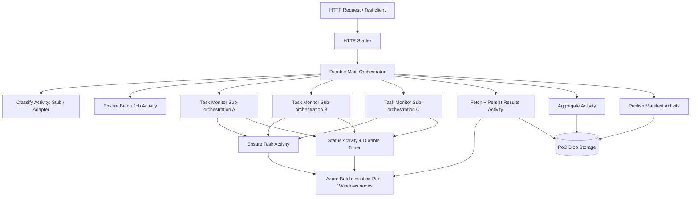

# Azure HPC マネージド化 PoC 設計書 — Durable Functions重点版

- 更新日: 2026-10-16
- 対象: HPC Pack / IBM Spectrum LSF から Azure Batch + Durable Functions への機能移管可能性の検証
- PoCの主目的: **Durable Functions による非同期ワークフロー制御の技術的実現可能性を確認する**
- 計算ノードOS: **Windows Server**
- 計算形態: 原則 **1 Task = 単一ノード内完結**
- フェーズ: 実装前設計（本設計書をもとに Codex へ実装を委譲する）

> **2026-10-17追記:** 本文は初版時点の設計書です。同時受付時の排他制御、一時障害に対するリトライ、およびタイムアウト時の Batch リソース停止処理については、追加承認された [信頼性改善の設計](workflow-reliability.md) を現行仕様とします。

## 0. 前提条件と基本方針

### 確認済みの前提
- Azure Batch Pool は Azure Compute Gallery（ACG）のイメージから展開した実績があり、必要な権限周りの調査も完了しています。
- 既存の HPC 業務には処理の軽量（Light）・重量（Heavy）を振り分ける分類処理が存在しますが、**本PoCでは業務判定ロジック自体の新規開発は行いません**。
- 実際の数値計算処理の再現性は今回の評価対象外とし、Windows ノード上で動作する軽量なダミー Task で代替します。
- 本PoCは HPC Pack や LSF の全機能を完全に代替できるかを検証するものではなく、**従来独自に作り込んでいたジョブ制御・状態管理の仕組みを Durable Functions でどこまで置き換えられるか（自前実装を削減できるか）** を確認することを第一の目的とします。

### 今回の設計方針
1. **既存の Batch Account / Batch Pool / ACG は参照専用として扱います。** Terraform で管理する対象は、原則として本PoC専用の Function App、状態管理用 Storage、結果格納用 Blob Container、監視リソース、および必要最小限の RBAC のみとします。
2. **使用する Batch Pool は1つのみとします。** Light / Heavy の判定は、処理分岐の記録と待機時間の差を模擬するためにのみ使用し、複数 Pool への振り分けや Task slot 数の細かな制御は今回のスコープには含めません。
3. **Windows 計算ノードで実行する Task には、OS標準搭載の `powershell.exe` による短いワンライナーを使用します。** 計算ノード向けの独自 Worker アプリケーションのビルドや配布は行いません。
4. **最短で検証を行うため、Batch Task がローカルに出力した結果ファイル（`result.txt`）を Functions の Activity から Batch File API 経由で取得し、Blob Storage へ保存する方式を採ります。** これにより、計算ノードへの Managed Identity 付与や Batch `OutputFiles` の設定を PoC の必須前提から外すことができます。なお、この方式は数KB程度の小規模データを扱う PoC 専用の経路であり、本番環境で大容量の計算結果を扱う際は Batch `OutputFiles` 等を用いてノードから直接 Blob へアップロードする方式を別途検討します。
5. **データの正本（Source of Truth）の分担**として、計算 Task の実行状態は Azure Batch、出力成果物は Blob Storage、ワークフロー全体の進行状態は Durable Functions をそれぞれの正とします。
6. **数百ノード規模での高負荷試験、高度なスケジューリング制御、および本番ワークロードの移植は本PoCのスコープ外とします。**

## 1. 本PoCで検証する項目

| 検証ID | 問い | 合格基準 |
|---|---|---|
| F01 | Durable Functionsから既存Batch PoolにWindows Taskを投入できるか | 3 Taskが実行され、Batch上のTask IDと状態が追跡可能 |
| F02 | 長時間の非同期待機を独自状態DBなしで実現できるか | Durable Timerで待機し、Functionを常時占有せず完了へ進める |
| F03 | ファンアウト・ファンインを記述できるか | 3つの監視用サブオーケストレーションを並行させ、全成功後に一度だけ集約へ進む |
| F04 | 再生・再起動から復旧するか | 待機中にPoC専用Function Appを再起動しても進行・状態が継続する |
| F05 | 異常終了や期限超過を表現できるか | 失敗Task/タイムアウト時は失敗状態と原因を記録し、最終公開しない |
| F06 | Blobを使う結果統合が可能か | 3つの小さな結果をBlobに格納し、期待値どおりの `aggregate.json` と `manifest.json` を生成 |

**成功判定の位置づけ:** F01〜F03、F05、F06 を P0（必須検証項目）とします。F04（プロセス再起動からの復旧）も Durable Functions を採用する価値を確認するうえで重要な項目であるため、可能な限りあわせて実施します。なお、大規模な並列実行性能や計算ノード障害時の高可用性については、本PoCの評価対象外とします。

## 2. 最小アーキテクチャ



- **Durable Functions**: オーケストレーション履歴の管理、非同期待機（タイマー）、リプレイによる状態復元、条件分岐、Fan-out / Fan-in、およびエラー伝播を担当します。
- **Azure Batch**: 既存 Pool 上での小規模 Task のキューイング・実行、実行状態の管理、および Task 出力ファイルの保持を担当します。
- **Blob Storage**: 各 Task の個別結果、集約結果（`aggregate.json`）、および最終公開用のマニフェスト（`manifest.json`）を保存します。
- **既存 ACG / Batch Pool**: 本PoCでは既存環境をそのまま利用し、**設定変更は行いません**。

### 利用するDurable Functionsの機能と削減できる自前実装

| Durable機能 | 利用箇所 | 実装しないで済むもの |
|---|---|---|
| Orchestrator / Activity | 段階ごとの処理管理 | 自前の業務状態遷移エンジン |
| Sub-orchestration + `Task.WhenAll` | 3 Taskの完了同期 | 共有DBのカウンタ、ロック、合流判定 |
| Durable Timer | Batch状態の再照会 | 常駐ポーラ、DBベースの待機スケジュール |
| 実行履歴・Replay | Functionプロセス再起動 | 独自チェックポイント / 復旧キュー |
| Instance ID / 状態照会 | トレース・進行表示 | 簡易ジョブ状態APIの独自DB管理 |

※ Durable Functions における Activity の呼び出し保証は At-least-once（少なくとも1回実行）であるため、外部 API に対する副作用の Exactly-once（厳密に1回のみの実行）はフレームワーク側では保証されません。そのため、後述するとおり Activity 側で冪等性を考慮した実装を行います。

## 3. P0 処理フロー

1. `POST /api/workflows` で `requestId`、`taskCount`（標準は3）、`classification`（`light`、`heavy`、`auto`）、および任意の `failTaskIndex` を受け取ります。
2. リクエスト内容を検証し、Durable オーケストレーションの `InstanceId` を決定して起動します。クライアントへは `202 Accepted` と状態照会用 URL（Durable 標準の管理 API）を返します。
3. `ClassifyActivity` でワークロードの分類（`light` または `heavy`）を判定します。本PoCでは Stub 実装とし、明示指定された場合はその値を採用、`auto` の場合は固定ルールで判定して、判定理由を出力に含めます。
4. `EnsureBatchJobActivity` が **既存 Pool を参照する** PoC 専用 ID の Batch Job を作成します（すでに同一 Job が存在する場合は構成の整合性を照合します）。
5. 3つの `MonitorBatchTaskOrchestrator`（サブオーケストレーション）を並列に起動します。各サブオーケストレーターは `EnsureBatchTaskActivity` で Task を投入し、`GetBatchTaskStatusActivity` による状態確認と `CreateTimer` による待機を Task が完了（成功または失敗）するまで繰り返します。
6. 親 Orchestrator は `Task.WhenAll` で3つのサブオーケストレーションの結果を待ち合わせます。いずれか1つでも失敗した場合は、**後続の集約処理へは進みません**。なお、P0 のシンプルさを優先し、一部の Task が失敗した際も実行中の他 Task は強制停止せず、全監視フローが終了した時点で親オーケストレーションを失敗（Failed）とする仕様とします（失敗時のキャンセル連鎖やタイムアウト時の強制停止は P1 項目とします）。
7. 3つの Task がすべて成功したら、`FetchAndPersistActivity` が Batch **Task File API** を用いて各 Task の `result.txt`（整数1行）を取得し、Blob Storage 上の `tasks/<taskId>/result.json`（Task ID・計算値・分類・Batch 関連 ID を含む）として保存します。
8. `AggregateActivity` が Blob 上の3件の `result.json` を読み取り、値の合計と Task 数を `final/aggregate.json` として書き出します。
9. `PublishManifestActivity` が集約結果の整合性を検証したうえで、`final/manifest.json` を条件付きで作成します。この `manifest.json` が存在することをもって、ワークフロー全体の最終成功とみなします。
10. 最後に Orchestrator は、最終ステータス（`Succeeded` / `Failed` / `TimedOut`）、Batch Job/Task ID、Blob URI などの**軽量なメタデータのみ**を出力として返します。

### Windows Batch Task の実行コマンド

概念例（実装時は Batch API における文字列エスケープやクォート処理を検証したうえで組み込むこと）:

```cmd
cmd /c powershell.exe -NoProfile -NonInteractive -Command "Start-Sleep -Seconds 10; Set-Content -Path result.txt -Value 1 -Encoding ASCII"
```

- Light と Heavy の違いは、数秒〜数十秒の **スリープ時間（待機時間）の差のみ** で表現します。実際の CPU やメモリ負荷をかける処理は不要です。
- 正常系の Task はカレントディレクトリ（作業ディレクトリ）の `result.txt` に整数 `1` を出力して終了コード `0` で終了し、失敗検証用の Task は意図的に非ゼロの終了コードで終了させます。
- Azure Batch のコマンドライン実行は暗黙的にシェルを介さない仕様であるため、先頭に `cmd /c` を明示します。
- 実環境の Windows Server 計算ノード上で PowerShell 5.1 が問題なく実行できることを事前に確認します。万一、実行ポリシーやセキュリティ設定により PowerShell がブロックされる環境であれば、`cmd.exe` 標準コマンドによる代替ワンライナーへ切り替えます。
- 同一ノード上での同時実行数の調整や厳密な CPU コア割り当てについては、今回の検証対象外とします。

## 4. Function定義

| 名前 | 種別 | 実行内容 |
|---|---|---|
| `StartWorkflow` | HTTP trigger | 入力検証、起動、202 + 管理URL |
| `MainOrchestrator` | Orchestration trigger | 軽重判定、Job作成、監視用子Orchestratorを3本起動、合流、結果集約、公開 |
| `ClassifyActivity` | Activity | 既存判定器との交換可能なStub |
| `EnsureBatchJobActivity` | Activity | PoC専用Batch Jobの作成・冪等照合 |
| `MonitorBatchTaskOrchestrator` | Sub-orchestration | 1 Taskの投入、状態監視、永続Timer待機 |
| `EnsureBatchTaskActivity` | Activity | 既存Task IDとの照合、投入 |
| `GetBatchTaskStatusActivity` | Activity | Batch実状態、終了コード、失敗情報の取得 |
| `FetchAndPersistActivity` | Activity | Task File APIから小結果取得→Blobへの書込 |
| `AggregateActivity` | Activity | 3つの結果から合計を計算しBlob保存 |
| `PublishManifestActivity` | Activity | 条件付きManifest発行 |

実装時は外部依存を切り離せるよう、`IBatchGateway`、`IResultRepository`、`IWorkloadClassifier` の各インターフェースを定義します。ただし、`IBatchGateway` の Mock / Fake 実装は**ローカルの単体テスト専用**とし、クラウド環境での F01 検証は必ず実際の Azure Batch に接続して判定します。

**オーケストレーターの決定性（Determinism）に関する制約:** Orchestrator 関数内では、外部 SDK の直接呼び出し、Blob I/O、`Task.Delay`、`DateTime.UtcNow`、および非決定的な乱数生成を行ってはなりません。現在時刻の取得には `TaskOrchestrationContext.CurrentUtcDateTime` を使用し、外部 I/O はすべて Activity 関数へ委譲します。また、ログ出力にはリプレイ安全なロガー（`CreateReplaySafeLogger`）を使用します。

## 5. 入出力インターフェース

**リクエストJSON例**

```json
{
  "requestId": "feasibility-001",
  "classification": "auto",
  "taskCount": 3,
  "failTaskIndex": null,
  "lightDelaySeconds": 5,
  "heavyDelaySeconds": 15
}
```

P0 では `taskCount` の指定範囲を 1〜3 に制限します。コマンドインジェクション等を防ぐため、入力された値や ID を無検証のままコマンドライン文字列へ埋め込むことは避けます。また、Batch の Job ID / Task ID は `requestId` を正規化・ハッシュ化して決定論的に導出し、Azure Batch の ID 文字種・文字数制約に適合させます。

**Blob 保存パス構成例**

```text
poc-results/
  runs/feasibility-001/
    tasks/task-00/result.json
    tasks/task-01/result.json
    tasks/task-02/result.json
    final/aggregate.json
    final/manifest.json
```

**aggregate.json の出力例**

```json
{
  "requestId": "feasibility-001",
  "taskCount": 3,
  "sum": 3,
  "taskIds": ["task-00", "task-01", "task-02"]
}
```

### P0 における冪等性の設計方針
- `requestId` から Batch Job ID / Task ID を一意かつ決定論的に生成し、すでに同一 ID が存在する場合は入力パラメータの整合性を照合します（内容が異なる場合は Conflict として扱います）。
- `StartWorkflow` において起動前にインスタンス状態を照会するだけでは、同時リクエストに対する完全な排他制御にはなりません。**同一 `requestId` の同時リクエストに対する厳密な排他保証は P1 の検討課題**とし、P0 では重複投入テスト時の挙動を観察・記録します。
- `FetchAndPersistActivity` と `AggregateActivity` は、再実行されても同一の入力に対して同一の内容を上書き保存できる設計とし、最終の `manifest.json` は条件付き作成（すでに存在する場合は内容の同一性を確認）とします。
- P0 では Batch Task の自動リトライ回数（`MaxTaskRetryCount`）は原則 `0` とします。ただし、Batch サービス側のノード障害復旧などに伴い Task が再実行される可能性は残る点に留意します。
- P0 では、ワークフローの最終状態を `Failed` とした後に残存している実行中 Task を強制停止する処理は実装しません。PoC 用に作成したジョブの手動クリーンアップ手順を README に記載します。

### P0 特有の制約事項
- 計算ノード上のローカルファイルは、ジョブの保持期間（retention time）やノードの再起動・縮退によって失われる可能性があります。そのため、**Functions から Batch Task File API 経由でファイルを読み取って Blob へ転送する方式は、小さなダミー結果を扱う本PoC専用の構成**と位置づけます。
- 本番環境で大容量の計算結果ファイルを扱う場合は、Batch の `OutputFiles` 機能や Managed Identity を用いた計算ノードから Blob Storage への直接アップロード、およびアップロード失敗時のリカバリ設計を比較検討する必要があります。
- Azure Batch において Task の状態が `Completed` になっただけでは正常終了とは限りません。必ず実行結果（`executionInfo`）の `exitCode` や `failureInfo` を確認して成否を判定します。

## 6. 検証シナリオと優先度

| テスト | 手順 | 期待結果 | 区分 |
|---|---|---|---|
| T01 | 3つのWindows Taskを投入 | 全Task成功し、結果3件と合計3がBlobに存在 | P0 |
| T02 | light/heavyを変更 | 分岐結果が履歴・ログ・成果物に残り、待機時間の差が確認可能 | P0 |
| T03 | 1 Taskを非ゼロ終了 | 親はFailed、aggregate/manifestを公開しない | P0 |
| T04 | 長めに待機するTaskを実行 | Durable Timer待機、状態照会が機能し、HTTP要求は即座に応答 | P0 |
| T05 | 待機中にPoC専用Function Appを再起動 | 再起動後に履歴から進行し、最終成果物が得られる | P0推奨 |
| T06 | Batch Taskは完了、Taskファイルが取得不能 | 明示的な失敗と原因を記録。成功扱いしない | P0 |
| T07 | 同一requestIdを同時に2回起動 | 受付側の競合とBatch ID重複時の挙動を観察 | P1 |
| T08 | Activity成功直後の中断を模擬 | 再実行でBatch重複Taskを作らない | P1 |
| T09 | OutputFilesによるBlob直送 | Functions経由の転送と差を比較 | P1 |
| T10 | ジョブ停止・キャンセル | DurableとBatch双方の停止・整合性を確認 | P1 |

PoC の実施記録として、少なくとも Durable の `instanceId`、Batch Job ID、Task ID、各 Activity の実行履歴、成功・失敗の判定結果、出力先 Blob URI、および各テストケースの実施結果をドキュメントに残します。

## 7. Terraform 構成方針（最小限）

### 原則として新規作成するリソース
- Function App およびホスティングプラン（Durable Functions が稼働するプラン）
- Durable 状態保存用 Storage Account および計算結果格納用の Blob Container（同一 Storage Account 内に PoC 専用コンテナを作成する形でも可）
- Function App のシステム割り当て Managed Identity
- Function App から Azure Batch および Blob Storage を操作するために必要最小限の RBAC ロール割り当て
- Application Insights および診断設定（最小構成）

### 既存環境を参照するリソース
- **既存の** Batch Account / Batch Endpoint、**既存の** Batch Pool ID、および **既存の** ACG イメージ（ACG イメージは参照可能であることの確認のみとし、変更は行いません）
- Resource Group についても既存利用を基本とし、明示的に指定した場合のみ新規作成できるようにします

### アプリケーション設定項目

```text
BATCH_ENDPOINT       = existing account endpoint
BATCH_POOL_ID        = existing Windows pool id
BLOB_CONTAINER       = poc-results
BATCH_POLL_SECONDS   = 10
WORKFLOW_TIMEOUT_MIN = 15
```

- Batch SDK および Blob SDK の認証には、`DefaultAzureCredential`（クラウド上では Managed Identity）を基本として使用します。
- 本番環境の権限設定や共有 Pool の設定変更・削除は一切行わず、PoC 専用のプレフィックス（`poc-`）を付与した ID のみで Batch Job や Blob を作成します。
- `terraform plan` の実行時に、管理対象外の既存リソースに変更や削除が発生しないことを必ず確認します。
- 既存の共有 Pool 上の Task スロットを利用する場合は、テスト実行前に空きノード状況や他利用者への影響を事前に確認します。

## 8. 実装の進め方（優先順位）

**Step A（最小経路の疎通確認）:** まず Windows Pool へ単一の Task を投入し、Task File API で `result.txt` を取得するところまでを通します。ここで Batch SDK の呼び出し、認証・権限、および Windows コマンドラインの実行が正しく動作することを確認します。

**Step B（メインワークフローの実装）:** Durable Functions の親・子オーケストレーター、3つの Task の並列待機、Durable Timer とリプレイ制御、Blob への結果保存・集約、および最終 `manifest.json` の出力までを一貫して通します。

**Step C（異常系・復旧系の検証）:** 意図的な非ゼロ終了（失敗注入）、Task 待機中の Function App 再起動、および結果ファイル取得失敗時の挙動を確認し、各テストの結果を記録します。

**Step D（次フェーズ以降の拡張検討）:** Batch `OutputFiles` による直接アップロード、重複リクエストの厳密な排他制御、失敗・タイムアウト時のキャンセル連鎖、複数 Pool や Light/Heavy スロット制御、および LSF 固有のスケジューリング機能との差分を調査します。

## 9. 本PoCの評価範囲外と結論の位置づけ

- 300ノード規模での実運用性能・コスト評価、本番の複雑なスケジューリングポリシーの再現、MPI 等の密結合並列計算、Fair Share、Backfilling、商用ソルバー等のライセンス管理、JP1 連携、および結果データの長期アーカイブ保管は本PoCの対象外です。
- **本PoCの成功は、ただちに LSF や HPC Pack の全機能をそのまま置き換え可能であることを意味するものではありません。** 本PoCで確認するのは、「単一ノード完結型の Task を束ねる基本ワークフローが Azure Batch + Durable Functions で成立し、自前の状態管理・ポーリング・リカバリ実装を大幅に削減できるか」という点です。

## 10. 実装時の主要な参照ドキュメント

- .NET isolated worker: https://learn.microsoft.com/en-us/azure/azure-functions/dotnet-isolated-process-guide
- Durable orchestrations and replay: https://learn.microsoft.com/en-us/azure/azure-functions/durable/durable-functions-orchestrations
- Durable Functions .NET isolated: https://learn.microsoft.com/en-us/azure/durable-task/durable-functions/durable-functions-dotnet-isolated-overview
- Durable programming model (Activity at-least-once): https://learn.microsoft.com/en-us/azure/azure-functions/durable/durable-functions-types-features-overview
- Batch .NET SDK: https://learn.microsoft.com/en-us/dotnet/api/overview/azure/compute.batch-readme
- Batch Windows command line: https://learn.microsoft.com/en-us/azure/batch/jobs-and-tasks
- Batch task-file API: https://learn.microsoft.com/en-us/rest/api/batchservice/tasks/get-task-file
- Batch OutputFiles (P1): https://learn.microsoft.com/en-us/azure/batch/batch-task-output-files
