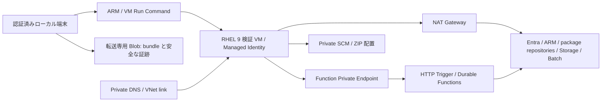

# 接続方式と共通ネットワークの設計

更新日: 2026-10-18

個人 PoC は、Azure VNet 内の RHEL 9 検証 VM から Function の Private Endpoint を呼び出す構成です。インフラ配置と VM 初期設定、Private SCM 配置、当時の 12 Functions の登録、3 Task の HTTP 投入・結果回収・`sum=3` の集約、標準シナリオ 6 件（`single` / `three` / `classification` / `failure` / `conflict` / `timeout`）の Pass、Function App 再起動復旧（`V05`）の Pass、Function ホスト停止中の Batch 側 `MaxWallClockTime` 安全網（`V08`）の Pass、および 0 台オートスケール Pool 先行投入（`V09`）の Pass は過去の実 Azure 実機検証（12 関数配置環境）で確認済みです（`admission20` は起動履歴取得の制限により `NotRun`、summary 終了コード `2`）。Function の公開ネットワークアクセス `Disabled` と Private Endpoint 接続 `Approved` も確認済みです。現行コード（コミット `5a45b17`、計 14 Functions、独自 URL 契約、エラー遮蔽、Activity 安全例外化、gRPC 3 コード限定再試行）の Azure 実機回帰検証は未実施です。Storage / Batch の全面閉域化および VPN / ExpressRoute 接続は後続フェーズで実施します。

## 1. 今回の構成

Batch の Windows 計算ノードは PoC 設定で Spot 1台・専用0台を要求します。Run Command の実行元となる RHEL 検証 VM は通常 VM のままとし、Spot 回収による配置・検証操作の中断を避けます。Function の Private Endpoint・NAT・DNS の設計に変更はありません。Spot の容量と結果回収の制限は [IaC 設計](one-command-deployment-inventory.md) を参照してください。

| 対象 | 今回の管理内容 |
|---|---|
| VNet / subnet | 検証 VM と Private Endpoint のサブネットを分離 |
| VM | RHEL 9、system-assigned Managed Identity、NIC Public IP なし、SSH 受信拒否。cloud-init で Azure CLI と PowerShell を準備 |
| 外向き通信 | VM subnet に NAT Gateway を関連付け、明示的な outbound 経路を確保。NAT 用 Public IP は送信に使用 |
| Function | 現行 B1 Dedicated plan を維持し、受信用 Private Endpoint と公開ネットワークアクセス無効化を構成 |
| DNS | privatelink.azurewebsites.net と VNet link を作成し、Function 本体と SCM の通常ホスト名を Private IP へ解決 |
| 操作 | ローカル端末から Azure Resource Manager 経由の VM Run Command を使用。VM への SSH 接続・VPN は不要 |
| 認証 | VM 内で az login --identity。HTTP トリガーは既存 Function key 認証を継続し、キーと Durable 管理 URL はメモリ内で扱う |
| 今回維持する公開通信 | Storage / Batch の公開データエンドポイント、ARM / Entra 認証、監視送信、cloud-init のパッケージ取得 |

Private Endpoint は受信専用です。今回 Function の Storage / Batch への送信を VNet Integration に切り替えることはしません。Private Endpoint の作成だけでは公開受信は遮断されないため、Function の公開ネットワークアクセス無効化を明示します。Private DNS では Function と SCM の双方を扱い、通常ホスト名と TLS を維持します。B1 は Private Endpoint 対応のプランです（[App Service Private Endpoint と SCM](https://learn.microsoft.com/en-us/azure/app-service/overview-private-endpoint)、[VNet Integration](https://learn.microsoft.com/en-us/azure/app-service/overview-vnet-integration)）。

VM の Public IP を省略しても外部サービスへの送信は必要です。NAT による明示的な送信経路を使用し、暗黙の default outbound access に依存しません。NAT は送信先ドメインの許可リストや送信検査を提供するものではありません（[NAT Gateway](https://learn.microsoft.com/en-us/azure/nat-gateway/nat-overview)、[VM Run Command](https://learn.microsoft.com/en-us/azure/virtual-machines/linux/run-command)、[Managed Identity での CLI 認証](https://learn.microsoft.com/en-us/cli/azure/authenticate-azure-cli-managed-identity)）。

## 2. 配置・検証経路と権限

ローカル端末の `deploy.ps1` は、アプリケーションの `build` / `test` / `publish` と Terraform の `plan` / `apply` を実行したのち、検証 VM 上から Private SCM エンドポイントへ ZIP を配置し、Functions の登録完了を確認します。独立検証の入口は `Invoke-PrivatePocValidation.ps1` とし、検証 VM 上で `Invoke-PocValidation.ps1` を実行します（`deploy.ps1` の `-Smoke` オプションは VM 上で 3 Task の HTTP ワークフローのみを実行し、単一 Task の検証は独立検証ランナーの `-Scenarios single` で実行します）。HTTP 受付を通じた Durable Functions の受付・監視・集約フロー全体を検証するため、`az batch job create` 等で Batch へ直接投入する方法は通常のワークフロー検証には使用しません。

検証 VM へのファイル転送と処理実行は `Invoke-PrivateVmOperation.ps1` に集約しています。ローカル端末でスクリプト・ZIP・必要な設定値をバンドル化して転送専用の Blob コンテナ（`poc-vm-control`）へアップロードし、検証 VM が自身の Managed Identity で取得します。VM Run Command 内で PowerShell ワーカー（`PrivateVm.Worker.ps1`）を実行し、機密情報を除外した証跡のみを Blob 経由でローカル端末へ回収します。転送用コンテナ `poc-vm-control` は匿名アクセス無効の専用コンテナとし、計算結果用コンテナ（`poc-results`）とは分離します。SAS トークンは発行せず、Function キー、Durable 管理 URL、アクセストークン、および生の機密応答は転送用引数や証跡ファイルに一切含めません。

| 主体 | 必要な権限 |
|---|---|
| デプロイ実行者 | リソース作成、対象スコープの RBAC 割り当てとカスタムロール定義の作成、VM Run Command の操作権限、および転送専用 `poc-vm-control` コンテナの `Storage Blob Data Contributor`（`validation_operator_principal_id` を指定した場合のみその ID へ IaC で付与し、未指定時は事前に付与） |
| VM Managed Identity | Function スコープのカスタムロール 6 操作（`sites/read`、`functions/read`、`functions/listkeys/action`、`host/listkeys/action`［再起動復旧検証時の状態照会用、実機ロールへ反映済み］、`config/list/action`、`publish/action`）、Batch Account スコープの `Azure Batch Account Reader`、Storage スコープの `Storage Blob Data Reader`、および `poc-vm-control` コンテナスコープの `Storage Blob Data Contributor` |
| Function Managed Identity | 現行の host Storage / 結果 Blob / Batch 操作権限（DTS 選択時は対象 Task Hub の `Durable Task Data Contributor` を追加） |

ローカル checkout から Git リビジョン・ソース fingerprint・package hash をバンドルに含めることで、`.git` ディレクトリを持たない検証 VM ゲスト内でも来歴情報を記録できるようにしています（これらは実行時に引き渡した来歴情報であり、ゲスト上でのソース再計算値や Azure ホスト上のロード済みバイナリの直接照合値とは区別します）。cloud-init の準備完了待機は最大 900 秒、以後のゲスト操作全体は最大 4200 秒（70 分）に制限し、Azure VM Run Command の 90 分上限内に収めます。検証ランナーの `TimeoutSeconds` はシナリオ内の待機上限（60〜3600 秒）であり、長時間を要する試験は `-Scenarios` を小分けにして実行します。Run Command は VM 上で任意のスクリプトを実行できる強い権限であるため、操作権限の付与先は管理者・検証担当者に限定してください。また、VM の Managed Identity によるログインだけで Function の HTTP トリガーが自動認証されるわけではなく、Function キーの取得権限と Private Endpoint へのネットワーク到達性が別途必要です。

環境設定ファイルへの追加入力項目は `validation_vm_ssh_public_key`、`validation_vm_admin_username`、`validation_vm_size`、および任意の `validation_operator_principal_id`（nullable GUID）です。SSH ポート自体は NSG で遮断しますが、Azure Linux VM のプロビジョニング要件として有効な SSH 公開鍵の指定が必須であるため、サンプル値は必ず実際の公開鍵へ置換してください（秘密鍵は設定ファイルや state に保存しません）。VM SKU・リージョン容量・クォータ・実行者権限・組織ポリシーは実環境への適用前に確認します。

## 3. 実機検証の完了条件

1. VM に Public IP がなく SSH 受信拒否であること、cloud-init と CLI / PowerShell の準備完了を確認する。
2. VM から Function と SCM の通常 FQDN が想定 Private IP に解決され、HTTPS が到達することを確認する。
3. Function の public network access が無効であることと、VNet 外の公開経路からのアクセス拒否を確認する。
4. VM Identity での認証・RBAC 反映、Private SCM への ZIP 配置、Functions 登録を確認する（過去の実機検証記録は 12 個、現行最新コードでは `GetWorkflowStatus` / `GetWorkflowResult` を含む計 14 個の登録確認を完了条件とする）。
5. VM から単一 Task・3 Task・分類・exit 42・再送・409 を検証する。期限停止は専用環境で実施する。20 並列の起動履歴を完全に証明できない制限は引き続き NotRun とする。
6. 証跡を回収し、キー・管理 URL・トークンを含まないことを確認する。転送 Blob と VM 作業領域の保持・清掃状態も記録する。

ローカル Mock / Fake や Terraform Mock の成功を、これらの Azure 実機検証の成功に繰り上げません。

## 4. 後続の全面閉域化

今回の VNet と将来の VPN / 既存 ExpressRoute の接続は責務を分離します。既存共有回線をアプリ Terraform state へ自動 import せず、共有ネットワーク参照・回線接続・ルーティング・オンプレ DNS 転送の所有者を個別に確定します。既存参照モードの導入、無停止切替、共有 Pool のネットワーク変更は今回の実装範囲に含めません。

全面閉域化では、受信用 Private Endpoint とは別の Function VNet Integration subnet を用意し、host Storage の Blob / Queue / Table と結果 Blob に Private Endpoint を作成します。現行 Dedicated plan は Azure Files コンテンツ共有を使用していないため、Files の Private Endpoint は必須にしません。ホスティングやプロバイダー変更時は依存関係を再評価します（[Functions Storage](https://learn.microsoft.com/en-us/azure/azure-functions/storage-considerations)、[Storage Private Endpoint](https://learn.microsoft.com/en-us/azure/storage/common/storage-private-endpoints)）。

| 用途 | Azure パブリッククラウドの Private DNS Zone |
|---|---|
| Function / SCM（今回） | privatelink.azurewebsites.net |
| Blob / Queue / Table（後続） | privatelink.blob.core.windows.net / privatelink.queue.core.windows.net / privatelink.table.core.windows.net |
| Batch 操作・ノード管理（後続） | privatelink.batch.azure.com。旧リージョン別ゾーンは公式の移行手順を個別適用 |

オンプレ DNS から Azure Private DNS Resolver への条件付き転送では正規サービスドメインを対象とし、VNet link と実際の問い合わせ結果を検証します。Private DNS Zone 作成のみを名前解決成功の証拠にはしません（[Private Endpoint DNS integration](https://learn.microsoft.com/en-us/azure/private-link/private-endpoint-dns-integration)）。

Batch は Job / Task 操作用 batchAccount とノード管理用 nodeManagement を分けて設計します。既存 Pool の target / current communication mode を確認し、Simplified 通信、ノード側 DNS、TCP 443、Blob 入出力等の依存を専用環境で実証してから公開アクセスを無効化します。通信モード変更には 0 台への縮小・再拡張や新 Pool への移行が必要となる場合があり、共有 Pool の自動変更は行いません（[Batch Private Endpoint](https://learn.microsoft.com/en-us/azure/batch/private-connectivity)、[Simplified 通信](https://learn.microsoft.com/en-us/azure/batch/simplified-compute-node-communication)）。

オンプレミス向け Web バックエンドや任意の小型 WebApp は認証・ジョブ所有者認可を持つ業務 API を提供し、Function key・Durable 管理 URL・SAS をブラウザへ返さない構成とします。API / WebApp は後続実装です。ARM、Entra ID、テレメトリ、パッケージ取得経路は Private Peering とは別に棚卸しします（[ExpressRoute routing](https://learn.microsoft.com/en-us/azure/expressroute/expressroute-routing)）。
