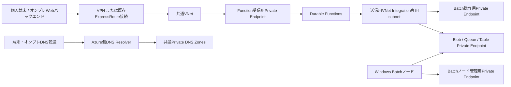

# 接続方式と共通ネットワークの設計

更新日: 2026-10-17

本書は次期ネットワークIaCの設計です。今回の変更ではVPN、ExpressRoute、VNet、Private Endpoint、WebAppを作成しません。個人検証環境では現行の公開endpointを使ってジョブ制御を先に検証し、業務環境では既存ExpressRouteに接続する構成を目指します。個人環境に業務環境の回線・DNS・権限があるとは仮定しません。

## 1. 接続経路と責務

- **アプリIaC**はFunction、Storage、アプリ側RBAC、Private Endpoint、VNet Integrationを管理します。受信と送信を分け、Private EndpointとIntegrationに別subnetを使用します。現行B1は両機能の対応tierですが、到達性は実環境で確認します。[App Service Private Endpoint](https://learn.microsoft.com/en-us/azure/app-service/overview-private-endpoint)、[VNet Integration](https://learn.microsoft.com/en-us/azure/app-service/overview-vnet-integration)
- **共通ネットワークIaC**は新規検証VNet/subnet/DNSを所有する構成と、既存IDを参照する構成を分けます。共有資源をアプリstateへ自動importしません。
- **接続側IaCまたは既存基盤**はVPN接続、ExpressRouteのVNet接続、経路、端末・オンプレDNS転送を担当します。既存ExpressRoute回線・private peeringの所有権や設定をアプリIaCへ移しません。
- この分割はIaC上の接続方式の差し替えです。無停止切替、既存Pool無変更、閉域化だけで認証・認可が完成することは保証しません。

## 2. 後続IaCの入力境界

以下は後続実装で追加する契約であり、現行の配置設定では未対応です。

| 入力グループ | 契約 |
|---|---|
| アプリ接続モード | `public` / `private`。既定は現在と同じ`public` |
| 共通ネットワーク | 新規作成または既存参照を明示。既存時はVNet ID、Integration subnet ID、Private Endpoint subnet ID、必要なPrivate DNS zone IDを入力 |
| VPN / ExpressRoute | アプリから独立した接続構成。既存接続は参照・到達性確認だけを行い、回線変更を含めない |
| Batch | 既存account/Poolの参照を維持。専用Pool作成・変更は別指定とし、共有Poolのresize、identity変更、通信モード変更を自動実行しない |
| 公開アクセス制限 | private経路の検証後、Function・Storage・Batchごとに段階適用。単一フラグで全資源を同時遮断しない |

private指定で必要IDが欠けた場合はplan前に失敗させ、公開経路へ自動fallbackしません。VNet/subnetのregion、委任、IP容量、経路の重複、DNS zone所有者とlink先を確認します。公開endpointのホスト名とアプリ契約を維持し、DNSでprivate IPへ解決する方式を用います。VNet Integrationは送信用でありFunctionへの受信経路にはなりません。[VNet Integration仕様](https://learn.microsoft.com/en-us/azure/app-service/overview-vnet-integration)

## 3. DNS・Storage・配置経路

Storageは入出力Blobだけでなく、Durable hostが使用するBlob・Queue・Tableを対象にします。現在の構成はcontent shareを無効化しているため、Azure Files用Private Endpointを必須にしません。将来hosting/storage方式を変える場合は依存を再評価します。[Functions Storage](https://learn.microsoft.com/en-us/azure/azure-functions/storage-considerations)、[Storage Private Endpoint](https://learn.microsoft.com/en-us/azure/storage/common/storage-private-endpoints)

| 用途 | Azure public cloudで使用するPrivate DNS zone |
|---|---|
| Function / SCM | `privatelink.azurewebsites.net` |
| Blob / Queue / Table | `privatelink.blob.core.windows.net` / `privatelink.queue.core.windows.net` / `privatelink.table.core.windows.net` |
| Batch操作・ノード管理 | `privatelink.batch.azure.com`。既存の旧region別zoneがあれば公式移行手順を個別適用 |

端末・オンプレDNSからAzure側Resolverの到達可能なinbound endpointへ条件付き転送を設定し、Private DNS zoneを必要VNetへlinkします。条件付き転送の対象は各サービスで推奨されるpublic DNS zone（例: `blob.core.windows.net`）とし、`privatelink` zone名だけを転送する構成にしません。zoneの存在だけでオンプレ名前解決が成立したと判定しません。[Private Endpoint DNS integration](https://learn.microsoft.com/en-us/azure/private-link/private-endpoint-dns-integration)

ZIP配置を行うホストはprivate SCMに到達できる必要があります。Function本体とSCMのDNS recordを確認し、配置ホストから両方の名前解決とTLS接続を試験してからpublic accessを無効化します。Azure CLIのARM認証、Entra、監視等の必要経路はprivate peeringとは別に棚卸しします。[SCM要件](https://learn.microsoft.com/en-us/azure/app-service/overview-private-endpoint#kuduscm-endpoint)、[ExpressRoute routing](https://learn.microsoft.com/en-us/azure/expressroute/expressroute-routing)

## 4. Batchと任意の小型WebApp

Batch操作の`batchAccount`とノード管理の`nodeManagement`は別subresourceです。後者はSimplified通信が対象です。accountのpublic network accessを無効にすると、ノードがpublic IPを持つ場合でもpublicなノード管理接続は拒否されます。private DNSとノードsubnetからPrivate EndpointへのTCP/443到達性を準備し、実ノードを確認してから制限します。既存の旧Batch DNS zoneと新zoneの混在は解決障害を起こし得るため、既存zoneを調査して移行します。[Batch Private Endpoint](https://learn.microsoft.com/en-us/azure/batch/private-connectivity)

Poolは`targetNodeCommunicationMode`だけでなく`currentNodeCommunicationMode`を確認します。既存Poolの切替では0台へのresize・再拡張や新規Poolへの移行が必要な場合があるため、専用fixtureで検証し、共有Poolへ適用する作業は別途計画します。ノード管理以外のBlob、アプリpackage、image等の依存先も試験対象です。[Simplified通信](https://learn.microsoft.com/en-us/azure/batch/simplified-compute-node-communication)

個人検証で小型WebAppを採用する場合は、認証付きサーバーをブラウザの入口とします。サーバーがFunction呼出しを担当し、Function key、Durable管理URL、SASをブラウザへ返しません。将来はWebAppの送信用IntegrationからFunctionのPrivate Endpointへ接続します。利用者認可・ジョブ所有者確認・API実装・WebApp配置は後続範囲です。現在の検証runnerを利用者向けWeb APIとして公開しません。

## 5. 移行と検証の順序

1. 個人環境では公開endpointで現行PoCのジョブ制御を検証し、結果を閉域接続の実証と区別する。
2. 接続方式、既存資源ID、IP範囲、DNS所有者、配置ホストを確定し、共通ネットワークIaCを実装する。
3. private経路を追加し、端末・Function・Batchノード・配置ホストごとにDNSと通信を照合する。
4. 単一Task、3Task、同時受付、期限停止をprivate経路で再検証する。host Storage接続とprivate SCMへのZIP配置も確認する。
5. 資源ごとにpublic accessを制限し、private接続成功・public接続拒否を確認する。不具合時は所有者の承認済み設定へ戻し、Job/Taskの観測状態を保存する。

Terraform MockやFakeによるローカル成功はAzure実接続の証拠にしません。現在、この構成のAzure到達性・private SCM配置・ノード管理は未検証です。
