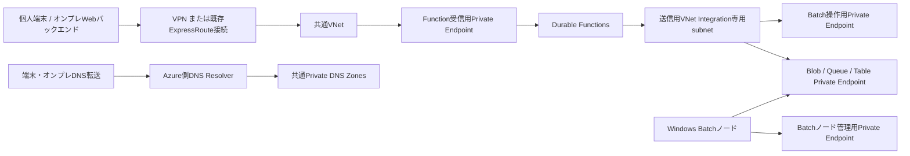

# 接続方式と共通ネットワークの設計

更新日: 2026-10-17

本書は次期ネットワークIaCの設計書です。現フェーズの作業ではVPN、ExpressRoute、VNet、Private Endpoint、WebApp等の新規リソース作成は行いません。個人検証環境では現行のパブリックエンドポイントを用いてジョブ制御ロジックを先行して検証し、将来の業務環境展開時に既存ExpressRouteへ接続する構成を目指します。なお、個人検証環境において業務環境と同等の回線・DNS・アクセス権限が利用可能であるとは仮定しません。

## 1. 接続経路と責務

- **アプリケーション用IaC**: Function App、Storage Account、アプリ側RBAC、受信用Private Endpoint、および送信用VNet Integrationを管理します。トラフィックの受信（インバウンド）と送信（アウトバウンド）を明確に分離し、受信用Private Endpointと送信用VNet Integrationには別々のサブネットを割り当てます。現行のApp Serviceプラン（B1）はいずれの機能にも対応しているTierですが、実際のネットワーク到達性については実環境上で検証します（参考: [App Service Private Endpoint](https://learn.microsoft.com/en-us/azure/app-service/overview-private-endpoint)、[VNet Integration](https://learn.microsoft.com/en-us/azure/app-service/overview-vnet-integration)）。
- **共通ネットワーク用IaC**: 新規検証用のVNet／サブネット／Private DNS Zoneをプロビジョニングして所有する構成と、既存のリソースIDをデータソースとして参照する構成を明確に分離します。既存の共有インフラ資源をアプリケーション側のTerraform stateへ自動インポートすることはしません。
- **接続環境用IaCまたは既存インフラ基盤**: VPN接続、ExpressRouteとVNet間の接続、ルーティング（ルートテーブル）、および端末・オンプレミス側のDNSフォワーダー設定を担当します。既存のExpressRoute回線やPrivate Peeringの管理権限・設定をアプリケーション側IaCに移管・混入させることはしません。
- **責務境界に関する補足**: この責務分離はIaCにおける接続方式の柔軟な切り替えを目的としたものです。本設計のみによって無停止でのネットワーク切り替えや、既存Batch Poolの完全な無変更維持、あるいはネットワーク閉域化のみでアプリケーションの認証・認可が充足することを保証するものではありません。

## 2. 後続IaCの入力境界

以下は後続実装で追加予定のインターフェース契約（パラメータ仕様）であり、現行のデプロイ設定では未対応です。

| 入力グループ | 契約・仕様 |
|---|---|
| アプリ接続モード | `public` / `private`。既定値は現在と同様に `public` |
| 共通ネットワーク | 新規作成または既存参照のいずれかを明示。既存参照時は VNet ID、Integration用サブネットID、Private Endpoint用サブネットID、必要なPrivate DNS Zone ID を指定 |
| VPN / ExpressRoute | アプリケーションから独立した接続構成。既存接続については参照および到達性確認のみを行い、回線自体の構成変更は行わない |
| Azure Batch | 既存のBatchアカウントおよびPoolの参照を維持。専用Poolの作成・変更は別パラメータとし、共有Poolのリサイズ、マネージドID変更、通信モード変更を自動実行しない |
| パブリックアクセス制限 | プライベート経路の疎通検証後、Function・Storage・Batchの各リソースごとに段階的に適用。単一フラグで全リソースを一括遮断しない |

`private` モードの指定時に必要なリソースIDが不足している場合は、Terraformの `plan` 実行前にバリデーションエラーとして停止させ、パブリックエンドポイントへの安易な自動フォールバックは行いません。事前検証として、VNet／サブネットのリージョン一致、サブネット委任（`Microsoft.Web/serverFarms`）、IPアドレス空間の空き容量、ルーティングの重複、Private DNS Zoneの所有者および仮想ネットワークリンクの適用状態を確認します。なお、アプリケーションの呼び出し規約や公開ホスト名は維持したまま、プライベートDNSによってPrivate IPへ名前解決させる方式を採用します。送信用VNet IntegrationはFunctionからのアウトバウンド専用であり、Function自身へのインバウンド受信経路としては機能しない点に注意が必要です（参考: [VNet Integration仕様](https://learn.microsoft.com/en-us/azure/app-service/overview-vnet-integration)）。

## 3. DNS・Storage・配置経路

閉域化の対象とするストレージリソースには、業務データの入出力用Blobだけでなく、Durable Functionsホストが内部状態管理に使用するBlob、Queue、Tableも含めます。現行構成ではApp Serviceプラン上で動作し `WEBSITE_CONTENTAZUREFILECONNECTIONSTRING` 等のコンテンツ共有（Azure Files）を使用しない構成としているため、Azure Files向けのPrivate Endpointは必須要件としません。将来的にホスティングプランやストレージプロバイダーの構成を変更する場合は、依存関係を再評価します（参考: [Functions Storage](https://learn.microsoft.com/en-us/azure/azure-functions/storage-considerations)、[Storage Private Endpoint](https://learn.microsoft.com/en-us/azure/storage/common/storage-private-endpoints)）。

| 用途 | Azureパブリッククラウドで使用するPrivate DNS Zone |
|---|---|
| Function / SCM | `privatelink.azurewebsites.net` |
| Blob / Queue / Table | `privatelink.blob.core.windows.net` / `privatelink.queue.core.windows.net` / `privatelink.table.core.windows.net` |
| Batch操作・ノード管理 | `privatelink.batch.azure.com`（※既存の旧リージョン別ゾーンが存在する場合は公式移行手順を個別に適用） |

端末およびオンプレミス側のDNSサーバーから、Azure側Private DNS Resolverの到達可能なインバウンドエンドポイントへ条件付きフォワーダー（Conditional Forwarder）を設定し、同時にPrivate DNS Zoneを対象のVNetへ仮想ネットワークリンクとして接続します。条件付き転送の対象ドメインは、Microsoftの推奨プラクティスに基づき各サービスの正規FQDN（例: `blob.core.windows.net`）とし、`privatelink` ゾーン名のみを直接転送する構成は採用しません。また、Private DNS Zoneを作成・配置したことのみをもってオンプレミスからの名前解決が確立できたとは判断せず、実際の名前解決クエリによる検証を行います（参考: [Private Endpoint DNS integration](https://learn.microsoft.com/en-us/azure/private-link/private-endpoint-dns-integration)）。

FunctionsへのZIPデプロイ（パッケージ配置）を実施するホスト（デプロイランナーや運用端末）は、Kudu（SCM: `<app-name>.scm.azurewebsites.net`）のプライベートエンドポイントにネットワーク到達できる必要があります。デプロイホストからFunction本体およびSCMエンドポイントの双方について、DNSレコードのプライベート名前解決とTLS/HTTPS接続が正常に通ることを事前に試験した上で、パブリックアクセスの遮断を実施します。また、Azure CLIやデプロイスクリプトが利用するAzure Resource Manager（ARM）の管理プレーン認証、Microsoft Entra ID認証、およびApplication Insights等の監視テレメトリ送信に必要な通信経路については、ExpressRouteのPrivate Peeringとは別系統（インターネット経由またはMicrosoft Peering等）として事前に棚卸しを行います（参考: [SCM要件](https://learn.microsoft.com/en-us/azure/app-service/overview-private-endpoint#kuduscm-endpoint)、[ExpressRoute routing](https://learn.microsoft.com/en-us/azure/expressroute/expressroute-routing)）。

## 4. Batchと任意の小型WebApp

Azure BatchのPrivate Endpointには、ジョブやタスク等の管理API操作を行う `batchAccount` と、計算ノードがBatchサービスと内部通信を行う `nodeManagement` という2つの異なるサブリソースが存在します（後者はSimplified Node Communicationモードが対象です）。Batchアカウントのパブリックネットワークアクセスを無効化すると、計算ノードがパブリックIPアドレスを保持している場合であっても、パブリック経路によるノード管理通信は拒否されます。そのため、Private DNSおよびノード用サブネットからPrivate EndpointへのTCP 443（HTTPS）到達性を事前に確保し、実際の計算ノードが正常に疎通できることを確認してからパブリック制限を適用します。なお、既存の旧リージョン別Batch DNSゾーン（`privatelink.<region>.batch.azure.com`）と汎用ゾーン（`privatelink.batch.azure.com`）が混在していると名前解決障害を引き起こすリスクがあるため、既存のゾーン構成を事前に調査した上で公式の移行手順に従います（参考: [Batch Private Endpoint](https://learn.microsoft.com/en-us/azure/batch/private-connectivity)）。

Batch Poolの通信方式を確認する際は、設定値である `targetNodeCommunicationMode` だけでなく、現在稼働中のノードに適用されている `currentNodeCommunicationMode` の両方を確認します。稼働中の既存Poolで通信モードを切り替えるには、ノード数を0台へ縮小（リサイズ）した後の再拡張や、新規Poolへのワークロード移行が必要となるケースがあるため、まずは専用の検証用Pool（fixture）で挙動を検証し、共有Poolへの適用は影響範囲を評価した上で別途作業計画を策定します。さらに、ノード管理通信だけでなく、ノードからストレージへの入出力Blobアクセス、アプリケーションパッケージ取得、コンテナイメージ取得などの依存通信についても、閉域網経由で問題なく疎通できるかを試験対象とします（参考: [Simplified通信](https://learn.microsoft.com/en-us/azure/batch/simplified-compute-node-communication)）。

個人検証環境で簡易的なWebフロントエンド（小型WebApp）を導入する場合は、ユーザー認証機構を備えたバックエンドサーバーをブラウザの直接の受け口として設計します。このバックエンドサーバーがAzure Functionsの呼び出しを仲介し、Functionキー、Durable管理URL、ストレージSASトークンなどの秘密情報をブラウザ側へ一切返却・露出させない構成を徹底します。将来的な閉域化においては、WebAppの送信用VNet IntegrationからFunctionの受信用Private Endpointへ閉域接続する構成とします。なお、エンドユーザー向けの認可制御、ジョブ所有権の照合、本番向けAPIの実装、およびWebApp自体のプロビジョニングは後続フェーズのスコープです。現在のPoC検証用ランナースクリプトをそのまま利用者向けWeb APIとして外部公開することはありません。

## 5. 移行と検証の順序

1. **公開エンドポイントによる先行検証**: 個人検証環境ではパブリックエンドポイントを用いて現行PoCのジョブ制御ロジックを検証し、その結果を閉域ネットワーク接続の実証結果とは明確に区別します。
2. **共通ネットワークの設計とIaC実装**: 接続方式、既存リソースID、IPアドレス帯、DNS所有者、およびデプロイホストの要件を確定させた上で、共通ネットワーク用IaCを実装します。
3. **プライベート経路の疎通確認**: プライベート接続経路を追加し、クライアント端末、Function App、Batch計算ノード、デプロイホストの各観点から、DNS名前解決とTCP/TLS通信の到達性を照合します。
4. **ワークフローの再検証**: 単一Task投入、3Task並列集約、同時受付排他、監視期限超過停止の各シナリオをプライベート経路経由で再検証します。あわせて、ホストStorage接続およびPrivate SCMへのZIPデプロイが正常に完了することを確認します。
5. **パブリックアクセスの段階的制限**: リソースごとに順次パブリックアクセスを無効化し、プライベート接続の成功とパブリック接続の確実な拒否（403等）を確認します。万一疎通に不具合が生じた場合は、所有者の承認済み設定へ速やかにロールバックし、その時点のJob/Task観測状態を証跡として保存します。

> **注意:** Terraform Mock やローカル Fake 実装によるテスト成功は、Azure実環境でのネットワーク疎通の証拠とは見なしません。現時点において、本構成におけるAzure実環境の到達性、Private SCM経由のZIPデプロイ、および計算ノード管理通信は未検証の段階です。
