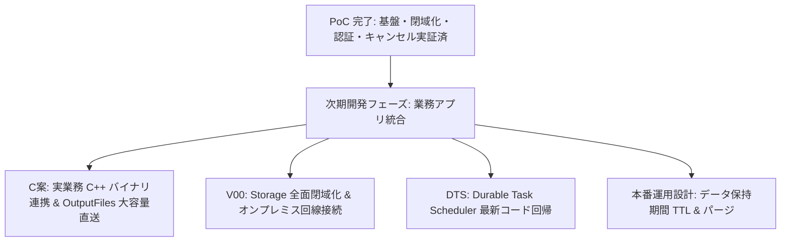

# 次期開発引き継ぎ計画（PoC 完了と次フェーズのバックログ）

更新日: 2026-10-19

## 1. 本書の目的とステータス

本 PoC は、Azure Batch（Windows ノード）と Durable Functions を組み合わせた計算基盤について、**クラウドアーキテクチャ・非機能要件の技術検証（A案・B案）を完了**しました。

これに伴い、PoC としての検証フェーズを終了し、本ドキュメントを**「次期開発フェーズ（実業務アプリ連携・本番化）への引き継ぎ計画書」**として再構成します。

App Service からの入力 Blob 受付、実業務データ契約、Windows Batch の実バイナリと大容量入出力、および Azure Storage 環境と並存する DTS 比較環境（別 RG/state/Function App/Storage/Task Hub、DTS Private Endpoint と最新コード回帰を含む）の具体要件は、[次期実装指示書](app-service-blob-batch-implementation-instructions.md) にまとめています。既存の [P0 実装指示書](CODEX_IMPLEMENTATION_INSTRUCTIONS.md) は当時の構成・履歴として扱い、次期実装では新指示書と合意済みの業務契約を適用します。Durable backend の接続設定だけを変更して既存履歴を移行するものではありません。

---

## 2. 実機検証済みの基盤範囲（完了項目）

以下の機能は、すべて実 Azure 環境上で正常動作（Pass）を確認済みです。

| 検証領域 | 実装内容 | 実機確認結果 |
|---|---|---|
| **ジョブオーケストレーション** | ・HTTP API によるジョブ受付と 202 応答 ・子オーケストレーションによる複数 Task の並列投入と集約（Fan-out / Fan-in） ・Durable Timer によるサーバーレス状態ポーリング | Pass (15関数稼働確認) |
| **受付排他・冪等性** | ・`admission.json` v2 と Durable Entity による二重起動防止 ・同一 `requestId`・同一所有者の冪等な結果返却 ・異なるパラメータ送信時の `409 Conflict` 拒否 | Pass (`conflict` 回帰確認) |
| **耐障害性・自動復旧** | ・Task 実行中の Function App 再起動からの無停止自動復旧（V05） ・監視期限超過時の Batch Job 有界停止（V07） ・Function ホスト停止時の Batch `MaxWallClockTime` 安全網（V08） ・0 台待機 Pool への先行投入と自動スケールアウト（V09） | Pass (実 Azure 復旧確認) |
| **利用者キャンセル（V12）** | ・取消 API（`POST /api/workflows/{requestId}/cancel`）の提供 ・`cancel.json` 先行永続化と Durable 外部イベント連携 ・Batch Job の有界停止と成果物公開の排他調停（`resolution.json`） ・他者キャンセル要求の 403 拒否と、停止完了後の 200 冪等応答 | Pass (`cancellation` 回帰確認) |
| **Entra サービス間認証 (B案-1)** | ・App Service EasyAuth v2 による未認証・不正トークンの 401 遮断 ・App Role（`Workflow.Execute`）不足マネージド ID の 403 遮断 ・稼働パッケージの暗号学的同定（`livePackageVerified: true`） | Pass (全 19 プローブ確認) |
| **ネットワーク完全閉域化 (B案-2,3)** | ・Function App の Regional VNet 統合（送信閉域化） ・Batch Account の Private Endpoint 化（`batchAccount`, `nodeManagement`） ・Batch Pool の VNet サブネット統合（`NoPublicIPAddresses`） ・Batch Account のパブリックアクセス完全遮断（`publicNetworkAccess: Disabled`） | Pass (閉域ノード上完走) |

---

## 3. 次期開発フェーズへの引き継ぎ項目（残課題バックログ）

本番開発および業務アプリ結合時に対応すべき残存タスクの一覧です。

### 3.1 【最優先】C案: 実 C++ バイナリ連携 & 大容量出力直送
実業務アプリケーションのバイナリ仕様およびデータ入出力仕様が確定した後に実施します。

1. **実 C++ 計算バイナリ連携 (V10)**:
   - 入力ライフサイクルの管理（アップロード中、確定状態の分離）。
   - 入力マニフェスト（Blob バージョン / ETag / ファイルサイズ / SHA-256）の生成と改ざん検証。
   - Windows 計算ノード上への固定バイナリ・依存 DLL・設定ファイルの配備（Batch `ResourceFiles` または Application Package）。
   - 計算結果のハッシュ突合および業務アプリ側の許容誤差検証。
2. **大容量出力の Blob Storage 直接アップロード (T09)**:
   - 現行の Task File API（数 KB 向け）から、Azure Batch の `OutputFiles` 機能を用いた計算ノードから Blob Storage への直接アップロードへ移行。
   - アップロード完了・全タスク正常終了・ハッシュ整合性を確認した後に `manifest.json` を公開する制御の実装。

### 3.2 DTS（Durable Task Scheduler）環境での最新コード実機回帰
- 過去の DTS 検証は 12 関数時点（キャンセル、EasyAuth、VNet 統合、Batch 閉域化の導入前）でした。
- 最新の 15 関数コードおよび閉域化設定を DTS 環境へ適用し、実機回帰試験を実施します。

### 3.3 V00: Storage 全面閉域化 & オンプレミス回線統合
- **Storage Account の Private Endpoint 化**:
  - Blob、Queue、Table、SCM デプロイ用 Storage の Private Endpoint を作成し、Storage のパブリックアクセスを遮断。
- **オンプレミス回線・DNS 統合**:
  - ExpressRoute Private Peering または Site-to-Site VPN 経由でのオンプレミス端末からの接続。
  - オンプレミス DNS サーバーから Azure Private DNS Resolver への条件付きフォワーダー構築。

### 3.4 本番運用・非機能要件の整備
- **データ保持期間（TTL）とクリーンアップ設計**:
  - 重複リクエスト抑止用インデックスと大容量結果データのライフサイクル管理（Blob ライフサイクルルール、オーケストレーション履歴の自動パージ運用）。
- **オンプレミス Web バックエンド連携仕様の確定**:
  - オンプレミス C# Web バックエンドからのクライアント証明書 / ワークロード ID 連携による Entra トークン取得と、利用者コンテキスト（`X-Poc-Owner-Id`, `X-Poc-Org-Id`）の伝播規約の正式合意。

---

## 4. 業務アプリ結合前に必要な確定情報

次期フェーズ着手にあたり、業務アプリチームおよびインフラ運用チームから受領が必要な項目です。

1. **実 C++ バイナリ仕様**:
   - 実行ファイル名、CLI 引数体系、必要なランタイム（VC++ Redistributable バージョン等）、依存 DLL 一覧。
2. **入出力データ仕様**:
   - シナリオデータ（入力）および計算結果（出力）の典型サイズ・最大サイズ、ファイルフォーマット。
3. **オンプレミス接続環境**:
   - 既存 ExpressRoute 回線または VPN の接続先 VNet、オンプレミス側の DNS フォワーダー構成。
4. **本番 Azure サブスクリプション環境**:
   - 本番用リソースグループ、Core クォータ（Spot / Dedicated）、マネージド ID 付与方針。
