# PowerShell スクリプト一覧と機能仕様（PowerShell Scripts Inventory）

更新日: 2026-10-18（コミット 5a45b17 時点）

本書は、本リポジトリ（`durable_functions_poc`）に含まれるすべての PowerShell スクリプト（`scripts/` 配下のメインスクリプト 11 本、および `scripts/tests/` 配下のオフライン単体・統合テストスクリプト 7 本）の役割、パラメータ、提供関数、実行境界、呼び出し関係、テスト検証観点、および終了コード仕様を体系的にまとめた技術仕様書です。

---

## 1. 概要とアーキテクチャ

本リポジトリのオートメーションおよび検証系は、Azure 上の Function App がパブリックアクセス無効（`publicNetworkAccess=Disabled`）の完全閉域構成で稼働することを前提として設計されています。そのため、スクリプト群は「ホスト側」と「ゲスト側」の 2 つの明確な実行境界に分離され、安全なトランスポート層を介して協調動作します。

### 1.1 2 つの実行境界

1. **ホスト側実行境界（Host Boundary）**:
   - **実行環境**: 操作者のローカル開発機（Windows 11 等、PowerShell 5.1 / PowerShell 7+）または CI/CD エージェント。
   - **担当機能**:
     - C# ソリューションのビルド、テスト、および Functions 発行成果物のパッケージング（`.NET SDK`）。
     - Terraform によるインフラプロビジョニング（Remote Backend ブートストラップおよび主インフラ `infra/`）。
     - Azure Batch Pool の準備状態・ノード数・オートスケール設定の管理プレーン監視・操作。
     - 検証用資材（スクリプト、ZIP パッケージ）をまとめたバンドルの生成と、制御用ストレージコンテナ（`poc-vm-control`）への転送。
     - Azure VM Run Command を用いた検証 VM 上でのゲストワーカー起動指示。
     - 耐障害性検証（`Invoke-PocRecoveryValidation.ps1`）における Function App の ARM REST / CLI 経由での再起動（`restart`）や一時停止（`stop` / `start`）。
     - サニタイズされた検証結果（`vm-operation.json`、`summary.json`、`summary.txt`）の回収と終了コード判定。

2. **ゲスト側実行境界（Guest Boundary）**:
   - **実行環境**: 同一 VNet 内に配置された閉域検証 VM（RHEL 9.8 / PowerShell Core `pwsh` 7.6.7）。Public IP なし・SSH 受信拒否。
   - **担当機能**:
     - Function App / Private SCM の Private DNS 名前解決が Private Endpoint 専用 IP に限定されているかの検証。
     - Azure CLI の Managed Identity（VM のシステム割り当て ID）を用いた Entra 認証トークンの取得。
     - Private SCM の `/api/zipdeploy` を用いた閉域内での Function App ZIP デプロイ。
     - プライベートネットワーク経由での HTTP ワークフロー開始 API（`/api/workflows`）の呼び出し。
     - Durable Functions の状態照会および Azure Batch / Blob Storage 成果物の直接突合検証。
     - 検証結果サマリの生成と、制御用ストレージコンテナへの安全なアップロード。

### 1.2 アーキテクチャとスクリプト呼び出し関係図

```mermaid
flowchart TD
    subgraph Host["ホスト実行境界 (Local PC / CI)"]
        deploy["deploy.ps1<br/>ワンコマンドデプロイ"]
        deployCommon["Deployment.Common.ps1<br/>共通基盤ライブラリ"]
        testDeployHost["Test-Deployment.ps1<br/>(Phase: Pool)"]
        privOp["Invoke-PrivateVmOperation.ps1<br/>VM Run Command トランスポート"]
        privVal["Invoke-PrivatePocValidation.ps1<br/>VM検証ラッパー"]
        recoveryVal["Invoke-PocRecoveryValidation.ps1<br/>(Host: restart / stop / start)"]
        autoscaleVal["Invoke-PocAutoscaleValidation.ps1<br/>0台Autoscale検証"]
        recoveryCtx["Recovery.Context.ps1<br/>コンテキスト検証"]
    end

    subgraph AzureMgmt["Azure 管理プレーン / コントロールプレーン"]
        arm["ARM / az CLI<br/>(Terraform / sites / batch)"]
        vmControlBlob["Blob Storage<br/>(poc-vm-control / operations)"]
        runCmd["VM Run Command<br/>(RunShellScript)"]
    end

    subgraph Guest["ゲスト実行境界 (閉域検証 VM: RHEL 9 pwsh)"]
        worker["PrivateVm.Worker.ps1<br/>ゲスト側エントリポイント"]
        testDeployGuest["Test-Deployment.ps1<br/>(Phase: Functions / Smoke)"]
        pocVal["Invoke-PocValidation.ps1<br/>標準シナリオ検証ランナー"]
        recoveryGuest["Invoke-PocRecoveryValidation.ps1<br/>(Invoke-PocRecoveryGuest)"]
        valAssertions["Validation.Assertions.ps1<br/>共通アサーション"]
    end

    subgraph PrivateResources["閉域プライベートリソース (VNet)"]
        pe["Private Endpoint<br/>(Function & SCM)"]
        funcApp["Azure Functions<br/>(Durable Functions)"]
        batch["Azure Batch<br/>(Windows Pool / Spot / Dedicated)"]
        blobData["Blob Storage<br/>(results / runs)"]
    end

    %% Host calls
    deploy --> deployCommon
    deploy --> testDeployHost
    deploy --> privOp
    privVal --> privOp
    recoveryVal --> privOp
    recoveryVal --> recoveryCtx
    autoscaleVal --> privOp
    autoscaleVal --> testDeployHost

    %% Host to Azure
    deploy -->|Terraform / az| arm
    privOp -->|Upload bundle.zip| vmControlBlob
    privOp -->|Invoke| runCmd
    recoveryVal -->|az functionapp restart/stop/start| arm
    autoscaleVal -->|Batch REST API| arm

    %% Run Command to Guest
    runCmd -->|Executes run.sh| worker
    worker -->|Download bundle.zip| vmControlBlob

    %% Guest internal
    worker --> deployCommon
    worker --> testDeployGuest
    worker --> pocVal
    worker --> recoveryGuest
    pocVal --> valAssertions
    pocVal --> deployCommon
    testDeployGuest --> valAssertions
    recoveryGuest --> valAssertions
    recoveryGuest --> recoveryCtx

    %% Guest to Private
    testDeployGuest -->|DNS / ZIP Deploy| pe
    testDeployGuest -->|Smoke HTTP| funcApp
    pocVal -->|Start HTTP / Status| funcApp
    pocVal -->|Direct Query| batch
    pocVal -->|Read JSON| blobData
    recoveryGuest -->|Start / Status| funcApp
    recoveryGuest -->|Verify Task| batch
    recoveryGuest -->|Verify JSON| blobData

    %% Results back
    worker -->|Upload result.json / summary| vmControlBlob
    privOp -->|Download sanitized results| vmControlBlob
```



### 1.3 セキュリティと機密保護方針

スクリプト群は、Azure 実機環境での検証時に機密情報（認証情報、API キー、Durable Webhook 管理 URL 等）がログやファイルへ流出することを防ぐため、以下の設計原則を徹底しています：

1. **Durable 管理 Webhook URL および system key のインメモリ限定取扱**:
   - Durable Functions の管理 Webhook（`/runtime/webhooks/durabletask/instances/...`）には、強大な権限を持つ system key（`durabletask_extension`）が含まれます。
   - `Validation.Assertions.ps1`（`Get-PocRecoveryStatusUri`）では、ARM の `functionapp keys list` API から取得した system key をメモリ内変数としてのみ保持し、URL を動的に組み立てます。
   - この URL は HTTP ポーリングの `Invoke-WebRequest` に直接渡され、ログファイル、環境変数、ディスク、コミット対象、およびテスト証跡（`summary.json` や `summary.txt`）には一切書き出されません。
   - 利用者向け公開 API（`statusQueryGetUri`）が管理 Webhook URL を露出していないことを `Assert-PocPublicStatusUri` で厳格に検証します。

2. **`-Sensitive` スイッチによるコマンド出力の秘匿**:
   - `Deployment.Common.ps1` の `Invoke-Tool` および `Invoke-AzJson` には `-Sensitive` スイッチが実装されています。
   - `-Sensitive` が付与されたコマンド呼び出しでは、ログファイルへの出力保存が無効化され、コマンドが失敗した場合でも例外メッセージ内の標準出力・標準エラー出力を伏字化（`"Command failed (exit $code); output suppressed because it may contain credentials or management URLs."`）して画面やログへの流出を防ぎます。

3. **Entra ID（Managed Identity）認証と SAS トークンの完全排除**:
   - ホスト・ゲスト間のデータ受け渡し用ストレージ（`poc-vm-control`）へのアクセスには、Azure CLI の `--auth-mode login` を使用します。
   - URL にシークレットが含まれる SAS トークン（Shared Access Signature）や Storage Account Key は一切使用せず、ディスクやリクエスト JSON にも保存しません。

4. **サニタイズされた証跡と構造化された失敗理由（PocValidationCode）**:
   - HTTP エラーレスポンスの本文や詳細な生スタックトレースは記録せず、あらかじめ定義された安全なコード（例: `InvalidStatusOrigin`, `HttpAuthorization401`, `ExpectedConflict409`, `BatchFingerprintMismatch`, `SetupFailed` 等）のみを `summary.json` の `Reason` として記録します。
   - VM 内での失敗は、定義済みのフェーズ（`failure_stage`: `dns`, `package_integrity`, `scm_publish`, `function_validation`, `validation_runner`, `validation_summary`, `summary_upload`）に分類して記録されます。

---

## 2. スクリプト分類表

| 分類 | スクリプト名 | 主な実行境界 | 概要 |
|---|---|---|---|
| **デプロイ・IaC統合** | [deploy.ps1](../scripts/deploy.ps1) | ホスト | ビルド、テスト、Terraform インフラ構築、Private VM デプロイ、検証を一貫実行する主スクリプト |
| **共通基盤** | [Deployment.Common.ps1](../scripts/Deployment.Common.ps1) | ホスト / ゲスト | CLI 実行制御、安全な JSON 変換、環境アイデンティティ照合、Terraform 計画ガード、ZIP 生成関数群 |
| **デプロイ検証** | [Test-Deployment.ps1](../scripts/Test-Deployment.ps1) | ホスト / ゲスト | Batch Pool ノード準備完了判定（Phase: Pool）、全 14 Functions インデックス確認、および Smoke テスト |
| **共通アサーション** | [Validation.Assertions.ps1](../scripts/Validation.Assertions.ps1) | ホスト / ゲスト | 公開ステータス URI 検証、メモリ内システムキー URL 生成、公開成果物（aggregate/manifest）整合性照合 |
| **ワークフロー検証** | [Invoke-PocValidation.ps1](../scripts/Invoke-PocValidation.ps1) | ゲスト（ローカル可） | 選択されたシナリオ（single/three/classification/failure/admission20/conflict/timeout）を実行・評価する主ランナー |
| **閉域VM検証ラッパー** | [Invoke-PrivatePocValidation.ps1](../scripts/Invoke-PrivatePocValidation.ps1) | ホスト | ホスト側から閉域検証 VM を起動して `Invoke-PocValidation.ps1` を実行させる簡易ラッパースクリプト |
| **VMトランスポート** | [Invoke-PrivateVmOperation.ps1](../scripts/Invoke-PrivateVmOperation.ps1) | ホスト | 資材バンドル作成、Blob 経由転送、Azure VM Run Command 実行、サニタイズ証跡回収を行うトランスポート層 |
| **VMゲストワーカー** | [PrivateVm.Worker.ps1](../scripts/PrivateVm.Worker.ps1) | ゲスト | 検証 VM 内で Run Command から呼び出され、DNS 検証、Private SCM ZIP デプロイ、検証ランナー実行を担う |
| **復旧コンテキスト** | [Recovery.Context.ps1](../scripts/Recovery.Context.ps1) | ホスト / ゲスト | 再起動復旧（V05）および停止時タイムアウト（V08）検証用コンテキストのスキーマ検証・日時正規化 |
| **耐障害性・復旧検証** | [Invoke-PocRecoveryValidation.ps1](../scripts/Invoke-PocRecoveryValidation.ps1) | ホスト / ゲスト | Function App 再起動復旧（V05）およびホスト停止中 Batch 安全網（V08）の実証ランナー |
| **オートスケール検証** | [Invoke-PocAutoscaleValidation.ps1](../scripts/Invoke-PocAutoscaleValidation.ps1) | ホスト | 0 台待機 Pool へのワークフロー先行投入による自動スケールアウトと完走、および復元を実証するランナー（V09） |

---

## 3. メインスクリプト詳細仕様（scripts/ 配下 11 本）

### 3.1 deploy.ps1

- **役割・目的**:
  ワンコマンドデプロイを実現する最上位オーケストレーションスクリプト。設定ファイル（`.psd1`）を読み込み、ツールの検証、C# の build/test/publish、Terraform state backend ブートストラップ、主インフラの `terraform apply`、Private VM を介した Function App の ZIP デプロイ、および配備後の疎通検証を一貫して実行します。
- **実行コンテキスト**: ホスト側
- **パラメータ一覧**:

| パラメータ名 | 型 | 必須/任意 | デフォルト値 | 用途・制約 |
|---|---|---|---|---|
| `-Environment` | `[string]` | 必須 | なし | 環境識別名（パターン: `^[a-z][a-z0-9-]{0,30}$`）。状態ファイル名（`<Environment>.tfstate`）等に使用 |
| `-ConfigFile` | `[string]` | 必須 | なし | 環境設定ファイルへのパス（例: `environments/poc.psd1`） |
| `-PlanOnly` | `[switch]` | 任意 | `$false` | インフラ計画（`terraform plan`）のみ実行し、リソース作成やコード配置をスキップするフラグ |
| `-Smoke` | `[switch]` | 任意 | `$false` | デプロイ完了後に 3 Task 構成のスモークテスト（`sum=3`）を実行するフラグ |

- **依存関係・呼び出し関係**:
  - ドットソース: `Deployment.Common.ps1`, `Test-Deployment.ps1`, `Invoke-PrivateVmOperation.ps1`
  - 外部コマンド: `dotnet` (restore/build/test/publish), `terraform` (init/validate/plan/apply/show/output), `az` (CLI >= 2.48.1)
  - 呼び出し先: `Invoke-PrivateVmOperation`（Operation: Deploy）
- **対応テストスクリプト**: `scripts/tests/Deploy.Workflow.Tests.ps1`

---

### 3.2 Deployment.Common.ps1

- **役割・目的**:
  デプロイおよび検証全体で共有されるユーティリティ関数群を提供する共通ライブラリ。ネイティブツールの安全な実行、JSON シリアライズ/デシリアライズ、環境アイデンティティの不変性検証、Terraform 実行計画の破壊的操作ガード、およびクロスプラットフォーム ZIP アーカイブの生成を行います。
- **実行コンテキスト**: ホスト側 / ゲスト側双方
- **主要な提供関数**:
  - `ConvertTo-DeploymentHashtable($Value)`: PSCustomObject や辞書オブジェクトを入れ子構造を含めて純粋な Hashtable へ正規化。
  - `Resolve-DeploymentTool($Name, $ConfiguredPath, $RepositoryRoot)`: 設定、システム PATH、または `.tools/` 配下からツールの実行可能バイナリパスを解決。
  - `Invoke-Tool($FilePath, $Arguments, $LogPath, [switch]$Sensitive)`: ネイティブバイナリを実行し標準出力を捕捉。`-Sensitive` 指定時はログ書き込みを抑制し、異常終了時に機密情報を含む出力をマスク。
  - `Invoke-AzJson($Arguments, [switch]$Sensitive)`: Azure CLI を `--only-show-errors --output json` 付きで実行し、JSON オブジェクトを返却。現在のサブスクリプション ID を自動付与。
  - `Write-DeploymentJson($Path, $Value)`: BOM なし UTF-8、Depth 30 で整形された JSON ファイルを保存。
  - `Get-DeploymentDurableSettings($Variables, [switch]$FromOutputs)`: `durable_backend`（`azureStorage` または `durableTaskScheduler`）と `durable_task_hub_name` を抽出・検証。
  - `Assert-DeploymentEnvironmentIdentity($Previous, $Current, [switch]$DurableOnly)`: 既存環境の状態ファイルや Durable バックエンド設定が無断で変更されることを防止。
  - `Assert-DeploymentPlan($Plan, $BatchMode)`: `terraform plan` の JSON 出力を解析し、リソースの意図しない削除・再作成（`delete` アクション）や既存 Batch/Gallery リソースの変更を検知してブロック。
  - `New-FunctionZip($PublishDirectory, $Destination)`: Linux 上の Functions ホストが `.azurefunctions` 等を正常に認識できるよう、エントリ名を明示的に POSIX スラッシュ（`/`）でフォーマットしたポータブル ZIP を生成。
- **パラメータ一覧**: ライブラリスクリプトのためルートパラメータなし。
- **依存関係・呼び出し関係**:
  - .NET アセンブリ: `System.IO.Compression`, `System.IO.Compression.FileSystem`
- **対応テストスクリプト**: `scripts/tests/Deployment.Common.Tests.ps1`

---

### 3.3 Test-Deployment.ps1

- **役割・目的**:
  インフラ構築完了直後、または VM 内デプロイ完了時におけるコンポーネントの準備完了判定（Readiness Check）およびスモークテストを実施するスクリプト。
- **実行コンテキスト**: ホスト側（Phase: Pool） / ゲスト側（Phase: Functions, All）双方
- **パラメータ一覧**:

| パラメータ名 | 型 | 必須/任意 | デフォルト値 | 用途・制約 |
|---|---|---|---|---|
| `-Outputs` | `[hashtable]` | 条件付必須 | なし | Terraform デプロイ出力情報（スタンドアロン直接実行時は必須） |
| `-TimeoutSeconds` | `[int]` | 任意 | `900` | 待機タイムアウト秒数（範囲: 1〜86400） |
| `-PollSeconds` | `[int]` | 任意 | `10` | ポーリング間隔秒数（範囲: 1〜60） |
| `-Phase` | `[string]` | 任意 | `'All'` | 検証フェーズ（ValidateSet: `'Pool'`, `'Functions'`, `'All'`） |
| `-Smoke` | `[switch]` | 任意 | `$false` | 準備完了確認に加えてスモークテスト（3 Task ワークフロー）を実施 |

- **主要な提供関数**:
  - `Invoke-ValidationHttp($Uri, $Method, $Headers, $Body)`: HTTP 要求ラッパー。URL 内のキーや認証エラーのシークレット露出を防止。
  - `Wait-ValidationCondition($Check, $Description, $TimeoutSeconds, $PollSeconds, [switch]$RetryErrors)`: 条件達成までの指数バックオフ・定期ポーリングを実行。
  - `Stop-Validation($Message)`: 恒久的な検証失敗例外をスロー。
  - `Invoke-DeploymentValidation`: Batch ノード状態確認、全 14 Functions の登録確認、およびスモークテストを実行する中核関数。
- **依存関係・呼び出し関係**:
  - ドットソース: `Validation.Assertions.ps1`, `Deployment.Common.ps1`
- **対応テストスクリプト**: `scripts/tests/Test-Deployment.Tests.ps1`

---

### 3.4 Validation.Assertions.ps1

- **役割・目的**:
  デプロイ検証（スモークテスト）および独立検証ランナー（`Invoke-PocValidation.ps1`）で共通して使用される、公開ステータス URI、内部診断用管理 URI、および Blob ストレージ上の最終成果物の正当性アサーション関数群。
- **実行コンテキスト**: ホスト側 / ゲスト側双方
- **主要な提供関数**:
  - `Get-PocRecoveryStatusUri($Outputs, $InstanceId)`: ARM 経由で取得した `durabletask_extension` system key を用い、内部診断用の Durable 管理 Webhook URL をメモリ内限定で生成。
  - `Assert-PocPublicStatusUri($StatusUri, $Outputs, $RequestId)`: クライアント向け状態照会 URI が HTTPS、同一ホスト名、クエリ/フラグメントなし、および `/api/workflows/{requestId}` 形式であることを厳格に照合。
  - `Assert-PocPublishedDocuments($RequestId, $TaskCount, $Aggregate, $Manifest, $BlobRoot, $JobId, $Fingerprint)`: `aggregate.json` と `manifest.json` の内容（requestId, sum, taskCount, status, jobId, fingerprint, 各 Task URI）の完全一致と整合性を照合。
- **パラメータ一覧**: ライブラリスクリプトのためルートパラメータなし。
- **依存関係・呼び出し関係**:
  - `Invoke-AzJson`（`Deployment.Common.ps1`）
- **対応テストスクリプト**: `scripts/tests/Test-Deployment.Tests.ps1`, `scripts/tests/PocValidation.Tests.ps1`

---

### 3.5 Invoke-PocValidation.ps1

- **役割・目的**:
  PoC の標準検証シナリオ群を一括実行し、ワークフロー開始から完了、Batch 計算結果、および Blob 成果物の整合性をエンドツーエンドで確認する主検証ランナー。実行結果を `summary.json` および `summary.txt` に出力します。
- **実行コンテキスト**: ゲスト側（閉域環境）、ホスト側（パブリック検証時）
- **パラメータ一覧**:

| パラメータ名 | 型 | 必須/任意 | デフォルト値 | 用途・制約 |
|---|---|---|---|---|
| `-DeploymentResultPath` | `[string]` | 任意 | `'./deployment-result.json'` | デプロイ結果ファイルのパス |
| `-Scenarios` | `[string[]]` | 任意 | `('single','three','classification','failure','admission20','conflict')` | 実行するシナリオ一覧（ValidateSet: `single`, `three`, `classification`, `failure`, `admission20`, `conflict`, `timeout`） |
| `-TimeoutSeconds` | `[int]` | 任意 | `900` | シナリオごとの最大待機秒数（範囲: 1〜86400） |
| `-PollSeconds` | `[int]` | 任意 | `10` | 状態照会ポーリング間隔秒数（範囲: 1〜60） |
| `-EvidenceDirectory` | `[string]` | 任意 | タイムスタンプ付きディレクトリ | 証跡ファイル（`summary.json` 等）の保存先パス |
| `-DedicatedEnvironment` | `[switch]` | 任意 | `$false` | 試験専用環境フラグ（`timeout` シナリオ実行時に必須） |

- **主要な提供関数**:
  - `Invoke-PocConcurrentAdmission`: `System.Net.Http.HttpClient` を用い、PowerShell ジョブ等で直列化させずに 20 多重の HTTP POST を真に並行送信。
  - `Get-PocValidationKey`: Function App から `StartWorkflow` の呼び出しキーを取得。
  - `Get-PocBatchObservation`: Azure Batch REST API から Job および全 Task の状態をページネーションを辿って取得。
  - `Get-PocIdentity` / `Get-PocFingerprint`: リクエストから決定論的インスタンス ID（`poc-<sha256[:40]>`）および入力フィンガープリントを計算。
  - `Invoke-PocScenario`: 個別シナリオの送信、ポーリング、Batch/Blob 照合を実施。
  - `Invoke-PocValidation`: シナリオ群を順次ディスパッチし、サマリと終了コード（0 / 1 / 2）を判定。
- **依存関係・呼び出し関係**:
  - ドットソース: `Deployment.Common.ps1`, `Validation.Assertions.ps1`
- **対応テストスクリプト**: `scripts/tests/PocValidation.Tests.ps1`

---

### 3.6 Invoke-PrivatePocValidation.ps1

- **役割・目的**:
  ホスト側から閉域検証 VM（RHEL 9）に対して `Invoke-PrivateVmOperation.ps1` 経由で検証処理（`-Operation Validate`）をディスパッチするためのシンプルな CLI ラッパースクリプト。
- **実行コンテキスト**: ホスト側
- **パラメータ一覧**:

| パラメータ名 | 型 | 必須/任意 | デフォルト値 | 用途・制約 |
|---|---|---|---|---|
| `-DeploymentResultPath` | `[string]` | 必須 | なし | デプロイ結果ファイルのパス |
| `-Scenarios` | `[string[]]` | 任意 | `('single','three','classification','failure','admission20','conflict')` | 実行対象シナリオ一覧 |
| `-TimeoutSeconds` | `[int]` | 任意 | `900` | タイムアウト秒数（範囲: 60〜3600） |
| `-EvidenceDirectory` | `[string]` | 任意 | タイムスタンプ付きパス | 証跡出力先ディレクトリ |
| `-DedicatedEnvironment` | `[switch]` | 任意 | `$false` | 専用環境指定フラグ |

- **依存関係・呼び出し関係**:
  - ドットソース: `Deployment.Common.ps1`, `Invoke-PrivateVmOperation.ps1`
- **対応テストスクリプト**: `scripts/tests/PrivateVm.Tests.ps1`

---

### 3.7 Invoke-PrivateVmOperation.ps1

- **役割・目的**:
  ホスト・閉域 VM 間のセキュアなトランスポート層を提供するスクリプト。必要なスクリプト群と要求パラメータ（`request.json`）を ZIP バンドル化し、Entra 認証で制御用ストレージにアップロードしたうえで、Azure VM Run Command（`RunShellScript`）を発行してゲスト側ワーカーを起動。完了後にサニタイズされた証跡ファイルを回収します。
- **実行コンテキスト**: ホスト側
- **パラメータ一覧**:

| パラメータ名 | 型 | 必須/任意 | デフォルト値 | 用途・制約 |
|---|---|---|---|---|
| `-Outputs` | `[hashtable]` | 必須 | なし | Terraform デプロイ出力情報 |
| `-Operation` | `[string]` | 必須 | なし | 実行操作（ValidateSet: `'Deploy'`, `'Validate'`, `'RecoveryStart'`, `'RecoveryComplete'`） |
| `-EvidenceDirectory` | `[string]` | 必須 | なし | 証跡ファイル回収先ディレクトリ |
| `-PackagePath` | `[string]` | 任意 | なし | 配置する Function App ZIP パッケージへのパス（Deploy 操作時に必須） |
| `-PackageSha256` | `[string]` | 任意 | `''` | ZIP パッケージの期待ハッシュ値 |
| `-TimeoutSeconds` | `[int]` | 任意 | `900` | 操作タイムアウト秒数（範囲: 60〜3600） |
| `-Scenarios` | `[string[]]` | 任意 | 既定シナリオ 6 件 | Validate 操作時の実行シナリオ |
| `-Smoke` | `[switch]` | 任意 | `$false` | Deploy 操作時にスモークテストを実施するフラグ |
| `-DedicatedEnvironment` | `[switch]` | 任意 | `$false` | 専用環境フラグ |
| `-RecoveryContext` | `[hashtable]` | 任意 | `@{}` | 復旧検証操作時のフェーズ間引き継ぎコンテキスト |

- **主要な提供関数**:
  - `Get-PrivateVmRunCommandStdout($Response)`: Linux VM Run Command の出力から `[stdout]` セクションのメッセージを抽出。
  - `Invoke-PrivateVmOperation`: バンドル生成、アップロード、Run Command 起動、結果回収を行う本体関数。
- **依存関係・呼び出し関係**:
  - ドットソース: `Recovery.Context.ps1`（復旧操作時のみ）
  - 外部コマンド: `git`（来歴ハッシュ算出用）, `az`（Blob アップロード/ダウンロード、VM Run Command 呼び出し）
- **対応テストスクリプト**: `scripts/tests/PrivateVm.Tests.ps1`

---

### 3.8 PrivateVm.Worker.ps1

- **役割・目的**:
  閉域検証 VM（RHEL 9）内部で Run Command からキックされるゲスト側の中核エントリポイント。ホストから渡された `bundle.zip` を展開し、プライベート DNS 解決の確認、Private SCM へのコード配置（Deploy）、検証ランナーの実行（Validate）、復旧検証（RecoveryStart / RecoveryComplete）を実行し、結果をアップロードします。
- **実行コンテキスト**: ゲスト側（RHEL 9 `pwsh`）
- **主要な提供関数**:
  - `Get-PrivateScmHost($Outputs)`: `az functionapp show` を使わず、最小権限（`sites/read`）の ARM REST GET で SCM ホスト名を直接取得。
  - `Assert-PrivateFunctionDns($Outputs)`: Function App および SCM のホスト名が、指定された Private Endpoint の内部 IP アドレスにのみ解決されることを検証。
  - `Publish-PrivateFunctionPackage($Outputs, $Path, $TimeoutSeconds)`: VM の Managed Identity トークンを用いて、Private SCM の `/api/zipdeploy?isAsync=true` に非同期 ZIP デプロイを行い、完了をポーリング。
- **パラメータ一覧**: 引数は受け取らず、同ディレクトリに展開された `request.json` を読み込んで動作。
- **依存関係・呼び出し関係**:
  - ドットソース: `Deployment.Common.ps1`, `Test-Deployment.ps1`, `Invoke-PocValidation.ps1`, `Invoke-PocRecoveryValidation.ps1`
- **対応テストスクリプト**: `scripts/tests/PrivateVm.Tests.ps1`

---

### 3.9 Recovery.Context.ps1

- **役割・目的**:
  耐障害性・復旧検証（Function App 再起動復旧 `V05`、およびホスト停止中 Batch 安全網 `V08`）において、ホストとゲスト間でやり取りされる復旧コンテキスト（開始時刻、Job ID、Task ID、MaxWallClockTime 等）のスキーマ定義、値検証、および UTC 日時正規化を担うライブラリ。
- **実行コンテキスト**: ホスト側 / ゲスト側双方
- **主要な提供関数**:
  - `Stop-PocRecoveryContext($Code)`: コンテキスト不正コードを持つ例外をスロー。
  - `Get-PocRecoveryIdentity($RequestId)`: 一貫したインスタンス ID を生成。
  - `Get-PocRecoveryTimestamp($Value)`: 日時文字列またはオブジェクトを ISO 8601 UTC 文字列へ正規化。
  - `Assert-PocRecoveryContext($Phase, $Context)`: `Start` フェーズおよび `Complete` フェーズで要求されるキー構成と値の正当性を厳格にアサート。
- **パラメータ一覧**: ライブラリスクリプトのためルートパラメータなし。
- **依存関係・呼び出し関係**: 外部スクリプトへの依存なし（独立したデータ契約ライブラリ）。
- **対応テストスクリプト**: `scripts/tests/RecoveryValidation.Tests.ps1`

---

### 3.10 Invoke-PocRecoveryValidation.ps1

- **役割・目的**:
  ワークフロー実行中の耐障害性を検証する専用スクリプト。以下の 2 つの検証モードをサポートします：
  1. **Restart モード（V05）**: Batch Task が `running` に入った直後に Function App を ARM 経由で `restart` し、同一 `instanceId`・同一 Task のまま再送なしで完了・整合することを実証。
  2. **HostStoppedBatchWallClock モード（V08）**: Batch Task が `running` に入った直後に Function App を `stop` し、ホストが停止した状態のまま Batch 側の `MaxWallClockTime` 制約により Job が自動終了（`MaxWallClockTimeExpiry`）すること、および `finally` で Function App が復元されることを実証。
- **実行コンテキスト**: ホスト側（`Invoke-PocRecoveryValidation`） / ゲスト側（`Invoke-PocRecoveryGuest`）双方
- **パラメータ一覧**:

| パラメータ名 | 型 | 必須/任意 | デフォルト値 | 用途・制約 |
|---|---|---|---|---|
| `-DeploymentResultPath` | `[string]` | 任意 | なし | デプロイ結果ファイルのパス |
| `-ExpectedFunctionAppName` | `[string]` | 必須 | なし | 誤操作防止用の期待 Function App 名 |
| `-ValidationMode` | `[string]` | 任意 | `'Restart'` | 検証モード（ValidateSet: `'Restart'`, `'HostStoppedBatchWallClock'`） |
| `-AllowFunctionRestart` | `[switch]` | 条件付必須 | `$false` | Function 再起動を明示的に許可する安全フラグ（Restart モードで必須） |
| `-AllowFunctionStop` | `[switch]` | 条件付必須 | `$false` | Function 停止を明示的に許可する安全フラグ（HostStopped モードで必須） |
| `-DedicatedEnvironment` | `[switch]` | 必須 | `$false` | 専用環境確認フラグ（必須） |
| `-DelaySeconds` | `[int]` | 任意 | `300` | Task 実行遅延秒数（範囲: 120〜600） |
| `-TimeoutSeconds` | `[int]` | 任意 | `900` | タイムアウト秒数（範囲: 300〜3600） |
| `-EvidenceDirectory` | `[string]` | 任意 | タイムスタンプ付きパス | 証跡保存先ディレクトリ |

- **主要な提供関数**:
  - `Get-PocBatchWallClockConstraintSeconds($Job)`: Batch Job の制約 XML 文字列から秒数をパース。
  - `Invoke-PocRecoveryGuest`: ゲスト VM 内で実行されるフェーズ処理（Start: 投入と Running 観測、Complete: 復旧後/停止後の完了確認）。
  - `Invoke-PocRecoveryValidation`: ホスト側で VM への指示と Function App の再起動/停止/開始をオーケストレーション。
- **依存関係・呼び出し関係**:
  - ドットソース: `Invoke-PocValidation.ps1`, `Invoke-PrivateVmOperation.ps1`（ホスト側のみ）, `Recovery.Context.ps1`, `Deployment.Common.ps1`
- **対応テストスクリプト**: `scripts/tests/RecoveryValidation.Tests.ps1`

---

### 3.11 Invoke-PocAutoscaleValidation.ps1

- **役割・目的**:
  Azure Batch Pool の 0 台待機オートスケール先行投入（`V09`）を実証するスクリプト。計算ノードが 0 台定常（`steady`）の状態にある Pool に対してワークフローを投入し、`$PendingTasks` の増加に伴う自動スケールアウト（1 台起動）、Task 完走、および `finally` ブロックでの固定台数構成への復元を一貫して検証します。
- **実行コンテキスト**: ホスト側
- **パラメータ一覧**:

| パラメータ名 | 型 | 必須/任意 | デフォルト値 | 用途・制約 |
|---|---|---|---|---|
| `-DeploymentResultPath` | `[string]` | 任意 | なし | デプロイ結果ファイルのパス |
| `-ExpectedFunctionAppName` | `[string]` | 必須 | なし | 期待 Function App 名 |
| `-ExpectedPoolId` | `[string]` | 必須 | なし | 期待 Batch Pool ID |
| `-AllowPoolAutoscaleTransition` | `[switch]` | 必須 | `$false` | Pool のオートスケール構成変更を明示的に許可する安全フラグ |
| `-DedicatedEnvironment` | `[switch]` | 必須 | `$false` | 専用環境確認フラグ |
| `-TimeoutSeconds` | `[int]` | 任意 | `1800` | タイムアウト秒数（範囲: 300〜3600） |
| `-EvidenceDirectory` | `[string]` | 任意 | タイムスタンプ付きパス | 証跡保存先ディレクトリ |

- **主要な提供関数**:
  - `Get-PocAutoscaleFormula($NodeType, $MaxNodes)`: `$PendingTasks` に基づくオートスケール数式文字列を生成。
  - `Invoke-PocBatchPoolRest($Method, $Uri, $Body)`: シェルエスケープ事故を防ぐため一時 JSON ファイル（`@file`）を用いた安全な Batch REST API コール。
  - `Wait-PocPoolSteady` / `Wait-PocPoolZeroNodes` / `Wait-PocAutoscaleIdleEvaluation`: Pool の定常化、0 台ノード化、および評価式収束を待機。
  - `Invoke-PocAutoscaleValidation`: スケールイン、Autoscale 式有効化、0 台確認、ワークフロー実行、スケールアウト確認、固定台数復元を実行する本体関数。
- **依存関係・呼び出し関係**:
  - ドットソース: `Deployment.Common.ps1`, `Test-Deployment.ps1`, `Invoke-PrivateVmOperation.ps1`
- **対応テストスクリプト**: `scripts/tests/AutoscaleValidation.Tests.ps1`

---

## 4. テストスクリプト詳細仕様（scripts/tests/ 配下 7 本）

すべてのテストスクリプトは、Azure への実接続や課金を一切発生させず、完全オフラインの Fake / Mock 環境で安全かつミリ秒〜秒単位で完結するように設計されています。

| テストスクリプト名 | テスト対象スクリプト | 検証観点・主なテストケース（モック/Fake による完全オフライン検証） |
|---|---|---|
| [Deployment.Common.Tests.ps1](../scripts/tests/Deployment.Common.Tests.ps1) | `Deployment.Common.ps1` | ・Terraform 実行計画（Plan）のガード（既存 Batch/Gallery の変更禁止、リソース削除・置換 `delete` の拒否）<br/>・オブジェクトの Hashtable 再帰変換と配列・入れ子構造の維持<br/>・Durable 設定（Azure Storage / DTS）のバリデーションと環境アイデンティティ変更の拒否<br/>・ポータブル ZIP 生成機能（`.azurefunctions` やネストされた DLL の POSIX パス検証、Windows バックスラッシュ `\` の混入防止） |
| [Deploy.Workflow.Tests.ps1](../scripts/tests/Deploy.Workflow.Tests.ps1) | `deploy.ps1`, `Test-Deployment.ps1`, `Invoke-PrivateVmOperation.ps1` | ・`deploy.ps1` の一連のワークフロー全体のオフライン完走テスト<br/>・Fake `dotnet` / Fake `terraform` / Fake `az` によるツール呼び出し順序および引数の照合<br/>・`-PlanOnly` 指定時の動作（ブートストラップ作成と主インフラ計画の分離、コードデプロイ抑止）<br/>・Remote Backend の RBAC 伝播待ちリトライ挙動<br/>・VM トランスポートの呼び出しパラメータ照合 |
| [Test-Deployment.Tests.ps1](../scripts/tests/Test-Deployment.Tests.ps1) | `Test-Deployment.ps1`, `Validation.Assertions.ps1` | ・Batch Pool 準備完了判定（Dedicated / Spot の種別判定、preempted/unusable ノードの除外、ページネーション継続 URL の検証、リサイズ失敗検知）<br/>・全 14 Functions インデックス登録の網羅確認（不足時の検出）<br/>・Smoke テストの HTTP 202 受理、独自 URL 検証、メモリ内システムキーによるステータス照会<br/>・Blob 上の `aggregate.json` / `manifest.json` 改竄検知アサーション |
| [PocValidation.Tests.ps1](../scripts/tests/PocValidation.Tests.ps1) | `Invoke-PocValidation.ps1`, `Validation.Assertions.ps1` | ・決定論的フィンガープリント計算の一致確認（C# `Poc.Core` とのクロスバリデーション）<br/>・標準シナリオ群（`single`, `three`, `classification`, `failure`, `conflict`, `timeout`, `admission20`）の Fake 応答検証<br/>・`System.Net.Http.HttpClient` による実ループバック 20 並行送信の検証<br/>・タイムアウト設定不足やランナー待機時間不足のバリデーション<br/>・終了コード仕様（Pass=0, Fail=1, NotRun含む=2）の網羅検証<br/>・シークレット文字列が証跡やログへ混入しないことの秘匿性検証 |
| [PrivateVm.Tests.ps1](../scripts/tests/PrivateVm.Tests.ps1) | `Invoke-PrivateVmOperation.ps1`, `PrivateVm.Worker.ps1` | ・ホスト・ゲスト間のトランスポート層（バンドル生成、SHA-256 検証、Entra 認証アップロード）の検証<br/>・Run Command の stdout/stderr 集約形式（`[stdout]` / `[stderr]`）からの正常判定抽出<br/>・Private SCM ホスト名解決時の権限最小化（`az functionapp show` ではなく ARM `sites/read` GET の利用）の検証<br/>・Private Endpoint DNS 解決検証<br/>・非同期 ZIP デプロイ（`/api/zipdeploy`）のポーリングと失敗ステージ追跡 |
| [RecoveryValidation.Tests.ps1](../scripts/tests/RecoveryValidation.Tests.ps1) | `Invoke-PocRecoveryValidation.ps1`, `Recovery.Context.ps1` | ・Function App 再起動復旧（Restart モード）のフェーズ分離実行（Start: Running 確認、Complete: 同一 ID・同一 Task 完了確認）<br/>・ホスト停止中 Batch 安全網（HostStoppedBatchWallClock モード）の検証（停止状態確認、MaxWallClockTimeExpiry 終了理由確認、Manifest 非公開確認）<br/>・`finally` ブロックでの Function App 再起動/復元コマンド発行の保証<br/>・コンテキストデータの日時改変や不正フィールドの拒否 |
| [AutoscaleValidation.Tests.ps1](../scripts/tests/AutoscaleValidation.Tests.ps1) | `Invoke-PocAutoscaleValidation.ps1` | ・0 台オートスケール検証（V09）のオフラインシーケンス確認<br/>・Batch REST API 呼び出し（`@file` による一時 JSON 経由）のパラメータ照合<br/>・Pool の 0 台縮小、Autoscale 式有効化、0 台確認、ワークフロー投入、スケールアウト検知の推移検証<br/>・`finally` ブロックにおける固定台数構成（Fixed Scale）への確実な復元と準備完了判定の検証 |

---

## 5. 終了コード仕様のまとめ

リポジトリ内の検証スクリプト群（特に `Invoke-PocValidation.ps1`、`Invoke-PrivatePocValidation.ps1`、`PrivateVm.Worker.ps1`、`Invoke-PocRecoveryValidation.ps1`、`Invoke-PocAutoscaleValidation.ps1`）は、自動化パイプラインや CI/CD での結果判定を一貫させるため、以下の統一された終了コード仕様に準拠しています：

| 終了コード | 状態 | 意味・判定条件 | 具体例 |
|---|---|---|---|
| **`0`** | **Pass** | 選択されたすべての検証シナリオ・テストが成功し、期待された成果物・状態がすべて確認された。 | `single`, `three`, `classification`, `failure`, `conflict` がすべて期待通り完走。復旧・オートスケール検証が成功。 |
| **`1`** | **Fail / Error** | 1 件以上のシナリオが失敗した、あるいは事前前提条件（Setup）の検証に失敗した。 | アサーション不一致、HTTP 500/404（リトライ上限超過）、Batch Task の異常終了、DNS 解決失敗、権限不足。 |
| **`2`** | **Contains NotRun** | 失敗（Fail）は 0 件であるが、安全上の制約や検証環境・機能の前提条件により実行を見合わせた（`NotRun`）シナリオが含まれている。 | `admission20` において、Entity の同時受付は確認できたが全世代のオーケストレーション起動履歴が API から網羅取得できないため一意性判定をスキップした場合。 |

### 5.1 PowerShell プロセス境界における終了コード伝播の重要事項

PowerShell の `-Command` パラメータ経由で外部スクリプトを呼び出す場合、PowerShell は内部の終了コードを自動的には外部プロセスの終了コードへ反映しません（最後の文がエラーでない場合、終了コードが `0` や `1` に丸められることがあります）。
そのため、`PrivateVm.Worker.ps1` や自動化スクリプト内では、呼び出しコードブロックの末尾に明示的に **`exit $LASTEXITCODE`** を付与して親プロセスへ正確にコード（特にコード `2`）を伝播させる実装としています。

```powershell
# 子 PowerShell プロセスから終了コードを欠損なく親へ伝播させる実装パターン
& pwsh -NoLogo -NoProfile -NonInteractive -Command {
    & ./Invoke-PocValidation.ps1 @args
    exit $LASTEXITCODE
}
$resultCode = $LASTEXITCODE
```

---

## 6. 相互参照リンク

本スクリプト群の設計方針、インフラ構成、および実機検証結果については、以下の関連ドキュメントも併せて参照してください：

- [README.md](../README.md): リポジトリ全体の目的、前提条件、デプロイコマンド、およびクイックスタートガイド。
- [validation-runner-flow.md](validation-runner-flow.md): `Invoke-PocValidation.ps1` による一括検証のシーケンス、ポーリング仕様、および詳細な内部フロー図。
- [one-command-deployment-inventory.md](one-command-deployment-inventory.md): `deploy.ps1` が操作する Terraform IaC 資材一覧、Batch Pool 構成、および管理境界の整理。
- [workflow-reliability.md](workflow-reliability.md): ワークフローの冪等性、リトライ、タイムアウト、および耐障害性の設計仕様。
- [reliability-validation.md](reliability-validation.md): Function App 再起動復旧（`V05`）、停止中 Batch 安全網（`V08`）、0 台オートスケール（`V09`）の検証手順と Azure 実機検証結果。
- [durable-task-scheduler-poc.md](durable-task-scheduler-poc.md): Durable Task Scheduler（DTS）バックエンドを採用した場合の構成、IaC 差分、および実機接続検証結果。
- [project-memory.md](project-memory.md): プロジェクトの歴史的経緯、コミットごとの変更記録、および設計決定のチェックポイント。
