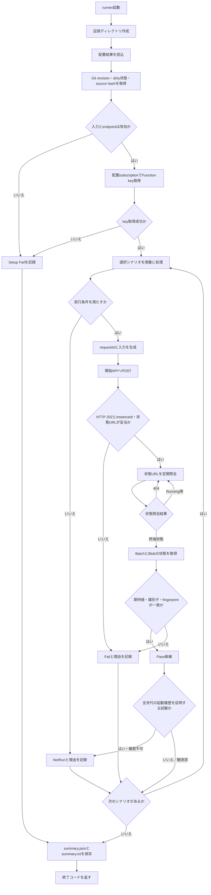
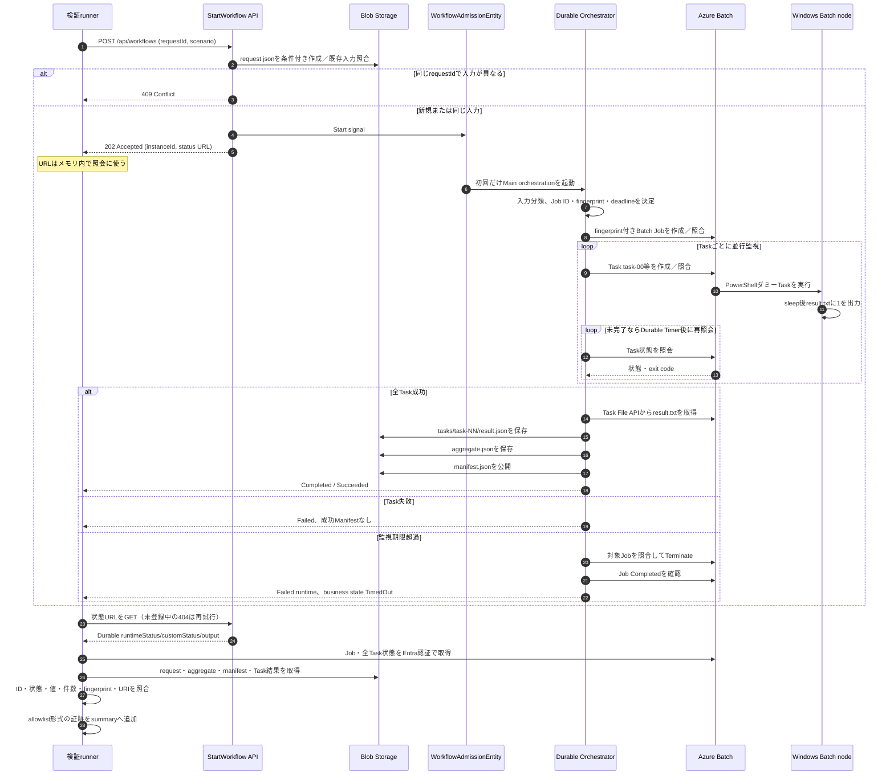

# 検証runnerの処理フロー

更新日: 2026-10-17

この文書は `scripts/Invoke-PocValidation.ps1` が行う検証と、開始APIからDurable Functions、Azure Batch、Blob Storageへ進む処理を記録します。個人検証での現行接続は公開endpointです。VPN／ExpressRoute、Private Endpoint、WebAppはこのrunnerが作成せず、将来構成は[ネットワーク接続設計](network-connectivity-design.md)を参照してください。

## runnerの全体フロー

runnerは既存配置結果を読み込み、選択したシナリオを順番に実行します。シナリオ内の分類試験と `admission20` のPOSTは複数処理を行います。

状態URLはHTTPS、同一Function Appのauthority、想定instance pathを検証します。初期404はEntity受付後にMain instanceが登録されるまでの待機として扱い、設定された待機上限を超えるとFailになります。HTTPエラー本文や秘密を含むURLは証跡へ出しません。

## 1件のワークフローのシーケンス

成功系では、runnerはDurable状態だけで判定せず、Batch TaskとBlobの結果も照合します。Batchノード上のコマンドは現在のPoC用ダミーで、待機後に `result.txt` へ整数 `1` を出力します。

期限超過でrunner自身の待機上限に達した場合、runnerは結果をFailとして記録します。runnerの停止はAzure側Jobの停止を意味しません。期限試験ではDurableのTimedOut状態、Batch JobのCompleted、Manifest不在をそれぞれ確認します。

## 生成物と保存先

| 保存先 | データ | 生成条件 |
|---|---|---|
| 実行端末 `artifacts/validation/<run>/` | `summary.json`、`summary.txt` | runnerの終了時。Setup失敗でも作成 |
| Azure Blob `runs/poc-<requestId>/request.json` | version、instanceId、ワークフロー入力 | API受付時 |
| Azure Batch Job | 決定的Job ID、Pool、fingerprint metadata、期限制約 | ワークフロー実行時 |
| Azure Batch Task | `task-00`等、Task command、fingerprint、exit/result | Task投入時 |
| Azure Blob `tasks/task-NN/result.json` | request/job/task identity、分類、fingerprint、値 | Batch Task成功後 |
| Azure Blob `final/aggregate.json` | Task ID一覧、件数、合計、fingerprint | 全Task結果照合後 |
| Azure Blob `final/manifest.json` | 成功状態、aggregateとTask結果のURI | すべて整合した成功時のみ |

summaryはGit revision・dirty flag・source SHA-256・配置結果のpackage SHA-256、試験別時刻と状態、選択したJob／Task観測値を記録します。認証値や管理URL、応答本文、生の例外を含めません。package hashは配置結果ファイルの値であり、稼働中hostが読んだバイナリのhashを直接測定したものではありません。

## シナリオと合格判定

| シナリオ | 実行内容 | Pass条件または留意点 |
|---|---|---|
| `single` | 1 Task | exit 0、Task結果1、aggregateとManifest整合 |
| `three` | 3 Task | Task 3件、各結果1、合計3 |
| `classification` | light、heavy、autoを各1回 | 分類値とTask結果が期待通り（現在autoはlight） |
| `failure` | 1 Taskをexit 42にする | 業務状態Failed、exit 42、成功Manifestなしなら試験Pass |
| `admission20` | 同じ入力で20並列POST後、完了後に再送 | 同じinstance・Task集合・完了状態を観測。全世代の起動履歴APIがないため最終結果はNotRun |
| `conflict` | 同じrequestIdに異なる入力をPOST | HTTP 409 |
| `timeout` | 専用設定でTaskを監視期限より長くする | Durable TimedOut、Batch停止完了、Manifestなし。専用環境指定と十分な待機時間がなければNotRun |

Exit codeは全選択シナリオPassで0、Failありで1、FailなしでNotRunありの場合2です。検証runnerはJob／Taskを作成するため、実Azure実行時にはBatch料金が発生し得ます。履歴、受付Entity、Job、結果Blobの自動削除はしません。

Fake試験、ローカルloopback HTTP試験、実C# fingerprint照合はrunner実装のローカル検証です。Azureでの実Pool、Durable host、Blob serviceによる実証とは区別し、Azure試験が未実施ならNotRunのまま記録します。
