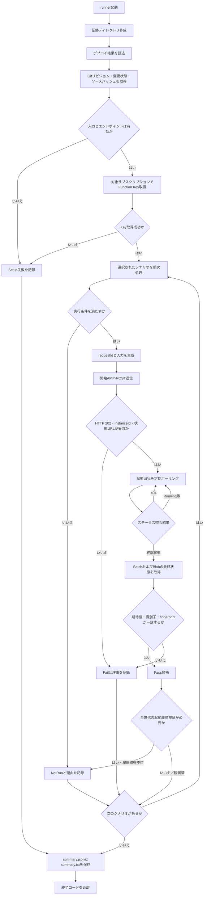
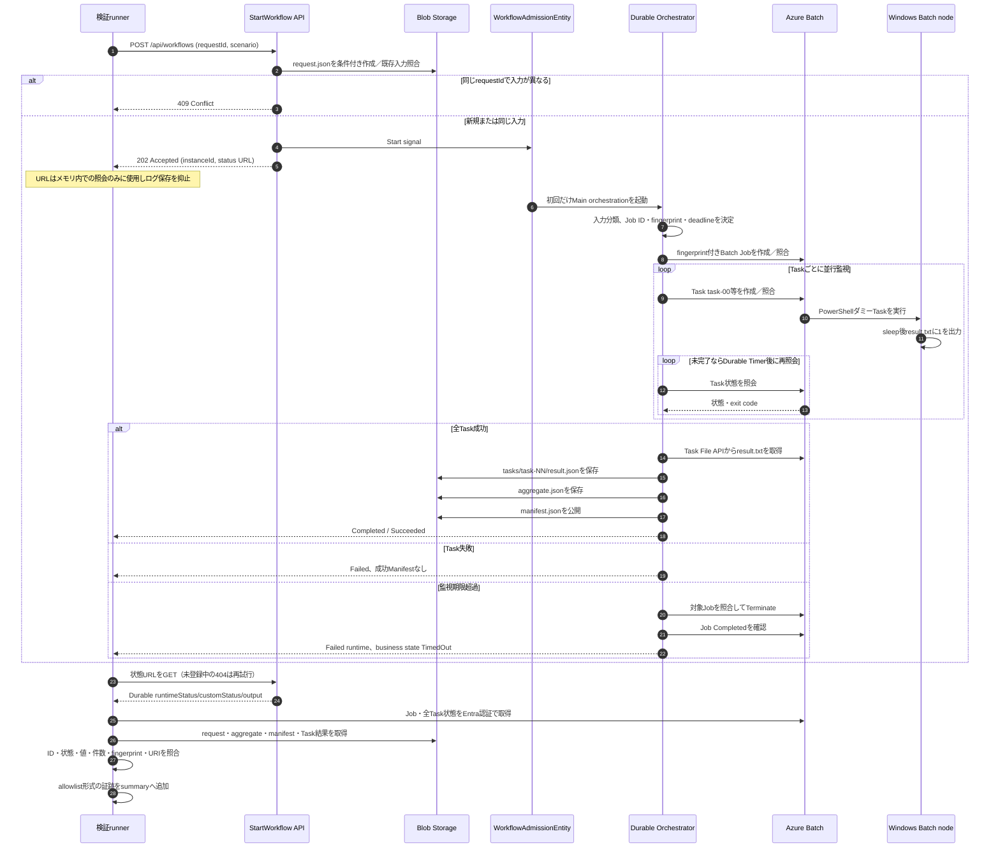

# 検証runnerの処理フロー

更新日: 2026-10-17

本書では、`scripts/Invoke-PocValidation.ps1` による一括検証の処理フローと、ワークフロー開始 API から Durable Functions、Azure Batch、Blob Storage へ至る一連のシーケンスを解説します。個人検証では `Invoke-PrivatePocValidation.ps1` が検証 VM の Run Command を起動し、VM 上から Function の Private Endpoint を呼び出します。Azure CLI は VM の Managed Identity でログインし、Function key を取得します。Function の公開ネットワークアクセスは無効化します。Storage / Batch の送信経路、VPN / ExpressRoute、Web App の後続構成については [共通ネットワーク設計](network-connectivity-design.md) を参照してください。

## runnerの全体フロー

VM 実行時の Git revision・ソース fingerprint・package hash はローカル checkout から bundle に含めて渡します。ゲストには .git はなく、来歴情報をゲスト checkout から再計算したものではありません。転送専用 poc-vm-control Blob と Run Command で実行・証跡回収を行います。cloud-init 待ちの900秒とゲスト操作全体の4200秒上限があり、長い検証は Scenarios を分割します。

runner はデプロイ結果ファイル（`deployment-result.json`）を読み込み、指定された検証シナリオを順次実行します。シナリオのうち `classification` は複数パターンのワークフローを連続実行し、`admission20` は HTTP 20 並行リクエストの送信を行います。

`summary.settings.batchNodeType` は配置設定の `dedicated` / `spot` を記録する欄であり、実ノードを観測した種別ではありません。Spot の回収・復旧はシナリオ対象外の `SpotEvictionRecovery` として記録します。`-DedicatedEnvironment` は試験専用環境の指定であり、専用 Batch ノードの指定ではないため Spot 環境でも使用します。

状態照会用 URL については、HTTPS プロトコル、同一 Function App のホスト（Authority）、および想定されるインスタンスパス形式を満たしているかを検証します。起動直後の HTTP 404 は、WorkflowAdmissionEntity の受付後に Main オーケストレーションインスタンスが登録されるまでの過渡的な状態として扱い、ポーリングを継続します（設定された待機上限を超過した場合は Fail となります）。なお、セキュリティ確保のため、HTTP エラーレスポンスの本文やシークレットを含む URL はログや証跡ファイルへ出力しません。

## 1件のワークフローのシーケンス

成功系の検証では、runner は Durable Functions のステータス照会結果のみに依存せず、Azure Batch の Job / Task 状態および Blob Storage 上の出力成果物も直接取得して突合します。なお、Batch 計算ノード上で実行される処理は本 PoC 用のダミーコマンド（PowerShell）であり、所定時間スリープした後に `result.txt` へ整数 `1` を書き出します。

ワークフローが想定時間を超過して runner 自身のタイムアウト上限に達した場合、runner は当該シナリオを Fail として記録します。この場合、runner の停止によって Azure 側の Batch Job が自動停止するわけではありません。一方、`timeout` シナリオの検証においては、Durable ワークフローの `TimedOut` 状態、Batch Job が適切に `Completed`（強制終了）されたこと、および成功時の `manifest.json` が生成されていないことをそれぞれ確認して合否を判定します。

## 生成物と保存先

| 保存先 | データ | 生成条件 |
|---|---|---|
| 実行端末 `artifacts/validation/<run>/` | `summary.json`、`summary.txt` | runner の終了時（Setup 失敗時にも出力） |
| Azure Blob `runs/poc-<requestId>/request.json` | version、instanceId、ワークフロー入力 | API 受付時 |
| Azure Batch Job | 決定論的 Job ID、Pool、fingerprint メタデータ、サーバー側期限制約 | ワークフロー実行時 |
| Azure Batch Task | `task-00` 等、Task コマンド、fingerprint 環境変数、終了コード・実行結果 | Task 投入時 |
| Azure Blob `tasks/task-NN/result.json` | リクエスト／Job／Task 識別子、分類、fingerprint、計算結果の値 | Batch Task 成功後 |
| Azure Blob `final/aggregate.json` | Task ID 一覧、Task 件数、合計値、fingerprint | 全 Task 結果照合後 |
| Azure Blob `final/manifest.json` | 成功状態、aggregate および各 Task 結果の Blob URI | 全 Task が正常終了し集計値が整合した場合のみ |

`summary.json` および `summary.txt` には、Git リビジョン、未コミット変更の有無（dirty フラグ）、ソースコード SHA-256、デプロイ結果パッケージの SHA-256、各試験の開始・完了時刻とステータス、ならびに Batch Job / Task の主要な観測値を記録します。シークレット、認証トークン、管理用 URL、生のレスポンス本文、例外スタックトレース等の機微情報は含めません。なお、パッケージハッシュ値はデプロイ結果ファイル（`deployment-result.json`）に記録された値であり、稼働中の Function App ホストがメモリにロードしたバイナリのハッシュを直接測定したものではありません。

## シナリオと合格判定

| シナリオ | 実行内容 | Pass条件または留意点 |
|---|---|---|
| `single` | 1 Task のワークフロー実行 | exit 0、Task 結果 1、aggregate および manifest が正常生成・整合 |
| `three` | 3 Task の並列ワークフロー実行 | Task 3 件、各結果 1、sum=3 の集計整合 |
| `classification` | light、heavy、auto を各 1 回順次実行 | 分類結果と Task 実行パラメーターが期待通り（現状 auto は light に解決） |
| `failure` | 1 Task を意図的に exit 42 で終了 | 業務ステータス Failed、exit 42 を検知、成功 manifest が出力されないことを確認 |
| `admission20` | 同一入力で 20 並列 POST を送信し、完了後に再送 | 同一インスタンス・同一 Task 集合・完了状態が維持されることを確認。ただし全世代のオーケストレーション起動履歴を網羅確認する API が存在しないため、最終ステータスは NotRun として記録 |
| `conflict` | 同一 requestId に対して異なる入力パラメーターで POST | HTTP 409 Conflict が返却されることを確認 |
| `timeout` | 監視期限より長い待機時間を指定した専用 Task を実行 | Durable が TimedOut、Batch Job が Terminate されて Completed、manifest が出力されないことを確認。`-DedicatedEnvironment` スイッチと十分なタイムアウトが指定されていない場合は NotRun |

スクリプトの終了コード（Exit code）は以下のとおりです。
- `0`: 選択されたすべてのシナリオが合格（Pass）
- `1`: 1 件以上の失敗（Fail）が存在する
- `2`: 失敗はないが、未実行・未実証の項目（NotRun）が含まれる

本検証 runner は実際に Azure Batch の Job および Task を作成するため、Azure 実環境での実行時には Batch ノードの利用料金が発生します。また、事後調査やエビデンス保持のため、実行履歴、受付 Entity、Batch Job、および結果 Blob の自動削除は行いません。

なお、Fake 試験、ローカルループバック HTTP 試験、C# による fingerprint 算出突合は、いずれも runner スクリプト自体のローカル動作検証です。Azure 実環境（実 Windows Pool、Durable Functions ホスト、Blob Storage サービス）での実証とは明確に区別し、Azure 環境での実行が完了していない項目は NotRun として記録します。
